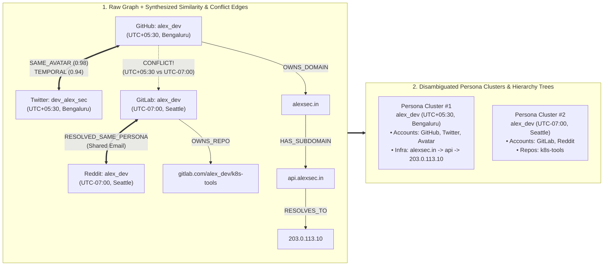

# OmniSINT — Comprehensive Engineering Milestones Chronicle (`Milestone.md`)

Welcome to the **OmniSINT Engineering Milestones Log**.

This document is written so that **anyone**—whether you are a first-time open-source contributor, a student learning cybersecurity, or a seasoned OSINT / Threat Intelligence specialist—can understand:
1. **What** was built in each milestone,
2. **Why** each feature exists (the real-world cybersecurity problem it solves),
3. **How** the underlying math, cryptography, graph theory, and databases work in plain English, and
4. **Concrete Examples** showing inputs, outputs, and Python code for every component.

---

## Quick Navigation

- [Introduction: What Is OmniSINT Doing Under the Hood?](#introduction-what-is-omnisint-doing-under-the-hood)
- [Milestone 0 (Task 0): Project Foundation, Configuration & Graphify AST Knowledge Graph](#milestone-0-task-0-project-foundation-configuration--graphify-ast-knowledge-graph)
- [Milestone 1 (Task 1): Core OSINT Ontology & Cryptographic Chain-of-Custody Engine](#milestone-1-task-1-core-osint-ontology--cryptographic-chain-of-custody-engine)
- [Milestone 2 (Task 2): Zero-Config Async SQLite Case Store & Quota-Saving TTL Response Cache](#milestone-2-task-2-zero-config-async-sqlite-case-store--quota-saving-ttl-response-cache)
- [Milestone 3 (Task 3): Mathematical Disambiguation Part 1 — Shannon Entropy, Handle Rarity, Multi-Modal Similarity & Circadian Fingerprinting](#milestone-3-task-3-mathematical-disambiguation-part-1--shannon-entropy-handle-rarity-multi-modal-similarity--circadian-fingerprinting)
- [Milestone 4 (Task 4): Mathematical Disambiguation Part 2 — NetworkX Knowledge Graph, Conflict-Aware Louvain Clustering & Information Hierarchy Tree](#milestone-4-task-4-mathematical-disambiguation-part-2--networkx-knowledge-graph-conflict-aware-louvain-clustering--information-hierarchy-tree)
- [Milestone 5 (Task 5): Citation-Locked AI Analyst, Identity Confidence Matrix & Hallucination Guardrail](#milestone-5-task-5-citation-locked-ai-analyst-identity-confidence-matrix--hallucination-guardrail)
- [Security, Custody & Accuracy Hardening (Post-Review Fixes)](#security-custody--accuracy-hardening-post-review-fixes)
- [Milestone 6 (Task 6): Pluggable Collector Framework + Username & GitHub/PGP Collectors](#milestone-6-task-6-pluggable-collector-framework--username--githubpgp-collectors)
- [Milestone 7 (Task 7): Infrastructure, Threat Intel & Search Dork Collectors](#milestone-7-task-7-infrastructure-threat-intel--search-dork-collectors)
- [Milestone 8 (Task 8): Async Scan Orchestrator, Cross-Indicator Pivot Engine & STIX 2.1 / Markdown Exporters](#milestone-8-task-8-async-scan-orchestrator-cross-indicator-pivot-engine--stix-21--markdown-exporters)
- [Milestone 9 (Task 9): FastAPI / WSGI Backend, WebSocket Live Stream & Cytoscape.js Interactive Web GUI](#milestone-9-task-9-fastapi--wsgi-backend-websocket-live-stream--cytoscapejs-interactive-web-gui)
- [Milestone 10 (Task 10): CLI, Interactive Terminal Dashboard (TUI) & End-to-End Integration Suite](#milestone-10-task-10-cli-interactive-terminal-dashboard-tui--end-to-end-integration-suite)
- [Milestone 11: Enterprise Security, Real-World Collector Expansion, API Governance & Disambiguation Benchmark](#milestone-11-enterprise-security-real-world-collector-expansion-api-governance--disambiguation-benchmark)

---

## Introduction: What Is OmniSINT Doing Under the Hood?

Imagine an investigator is given a single username—say, **`alex_dev`**—to investigate after a security incident.
If you search for `alex_dev` across the internet using traditional tools, you run into four massive problems:

1. **Unstructured Chaos:** GitHub returns JSON about repositories, Certificate Transparency (`crt.sh`) returns SSL certificate records, and social platforms return profile pages. Nothing speaks the same language. *(Solved in **Milestone 1**)*
2. **No Proof of Authenticity:** If you save a JSON file to your desktop, anyone can open it in a text editor and change a username or IP address. In a real investigation, you need cryptographic proof that the evidence was not altered after collection. *(Solved in **Milestone 1 & Milestone 2**)*
3. **The "Same Name, Different Person" Collision Problem:** There might be 15 different people named `alex_dev` on different websites—one in Bengaluru (`UTC+05:30`), one in Seattle (`UTC-07:00`), and one in London (`UTC+00:00`). Conversely, the *real* target might use `alex_dev` on GitHub and a slightly rearranged handle like `dev_alex_sec` on Twitter with the same profile picture. *(Solved mathematically in **Milestone 3 & Milestone 4**)*
4. **AI Hallucinations:** If you ask a standard AI chatbot to write a report on your findings, it might invent connections or guess details that aren't in the evidence. *(Solved in **Milestone 5**)*

Each milestone below builds one layer of this pipeline.

---

## Milestone 0 (Task 0): Project Foundation, Configuration & Graphify AST Knowledge Graph

**Status:** Completed  
**Files Created:**
- [AGENTS.md](file:///Users/alex/OmniSINT/AGENTS.md)
- [pyproject.toml](file:///Users/alex/OmniSINT/pyproject.toml)
- [.env.example](file:///Users/alex/OmniSINT/.env.example)
- [omnisint/config.py](file:///Users/alex/OmniSINT/omnisint/config.py)
- [scripts/update_code_graph.py](file:///Users/alex/OmniSINT/scripts/update_code_graph.py)
- [graphify-out/GRAPH_REPORT.md](file:///Users/alex/OmniSINT/graphify-out/GRAPH_REPORT.md) & [graphify-out/graph.json](file:///Users/alex/OmniSINT/graphify-out/graph.json)

### 1. Why Does This Milestone Exist? (The Problem It Solves)
Before writing complex intelligence algorithms, a project needs:
1. **Centralized, Validated Configuration (`omnisint/config.py`):** Hardcoding file paths, timeouts, or API keys inside code is dangerous and brittle. We need a single Pydantic v2 settings class (`OmniSINTSettings`) that reads environment variables (`OMNISINT_*`) and validates them (for example, ensuring timeouts and concurrency limits are positive numbers) while providing sensible defaults so the platform works out-of-the-box with zero configuration.
2. **Automated Codebase Map (`scripts/update_code_graph.py`):** As a codebase grows past dozens of classes and hundreds of functions, both human contributors and AI coding agents waste time searching through files to understand what imports what. The Graphify AST indexer parses every Python file using Python's `ast` module and builds an architectural map (`graphify-out/GRAPH_REPORT.md`) showing every module, class, function, and high-centrality "God Node."

### 2. What Was Built in Detail
- **`OmniSINTSettings` (`omnisint/config.py`):**
  - `database_path`: Defaults to `.omnisint_data/omnisint.db`.
  - `cache_ttl_seconds`: Defaults to `86400` (24 hours) so repeated OSINT queries use cached responses instead of hitting external APIs.
  - `http_timeout_seconds` (`15.0s`) and `max_concurrent_requests` (`10`) to prevent overwhelming external servers.
  - Optional API keys (`github_token`, `virustotal_api_key`, `google_cse_api_key`, `llm_api_key`).
  - `llm_provider`: Defaults to `"deterministic"` (100% offline), with support for `"gemini"`, `"openai"`, and `"ollama"`.
- **AST Knowledge Graph Builder (`scripts/update_code_graph.py`):**
  - Scans `omnisint/`, `scripts/`, and `tests/`.
  - Extracts every module, class definition, method list, function signature, import edge, and class inheritance edge.
  - Computes node degree centrality to identify core abstractions and writes both machine-readable `graphify-out/graph.json` and human-readable `graphify-out/GRAPH_REPORT.md`.

---

## Milestone 1 (Task 1): Core OSINT Ontology & Cryptographic Chain-of-Custody Engine

**Status:** Completed  
**Files Created:**
- [omnisint/core/models.py](file:///Users/alex/OmniSINT/omnisint/core/models.py)
- [omnisint/core/custody.py](file:///Users/alex/OmniSINT/omnisint/core/custody.py)
- [omnisint/core/\_\_init\_\_.py](file:///Users/alex/OmniSINT/omnisint/core/__init__.py)
- [tests/test_models_and_custody.py](file:///Users/alex/OmniSINT/tests/test_models_and_custody.py)

### 1. Why Does This Milestone Exist? (Plain-English Explanation)

#### Problem A: "Different Collectors Speak Different Languages"
When you query GitHub, you get back a "user profile" and "repositories." When you query a DNS server, you get back "domains," "subdomains," and "IP addresses." When you inspect an image, you get a "perceptual hash."
To analyze all of these together in one graph, we need a **Unified Ontology** (`omnisint/core/models.py`)—a strict set of building blocks where every piece of information is represented as an **`EntityNode`** (a noun/vertex) connected by a **`RelationshipEdge`** (a verb/link).

#### Problem B: "How Do You Prove OSINT Evidence Wasn't Faked?"
Suppose an analyst collects a JSON response from GitHub showing that a suspect used a specific email address, and two weeks later the suspect deletes their GitHub account. How does the analyst prove the JSON wasn't edited by hand on the analyst's laptop?
We solve this with an **OSINT Pilot-Standard Chain of Custody** (`omnisint/core/custody.py`):
1. Every raw response is converted into a canonical byte sequence and hashed with **SHA-256** (a 64-character cryptographic fingerprint).
2. Each new `EvidenceItem` includes the `chain_hash` of the item collected right before it—forming an **immutable cryptographic chain** starting from a Genesis hash (`0000...0000`).
3. If anyone modifies even a single digit in Evidence #1 later on, its SHA-256 hash changes, breaking the chain for Evidence #1, #2, #3, and so on!

### 2. Concrete Example: How Hash Chaining Detects Tampering

```text
[GENESIS: 0000...0000]
         │
         ▼
┌──────────────────────────────────────────────────────────┐
│ Evidence #1 (GitHub API JSON: {"karma": 450})            │
│ • sha256_hash:     a1b2c3...                             │
│ • prev_chain_hash: 000000... (Genesis)                   │
│ • chain_hash:      SHA256(prev || id || sha256 || uri)   │
│                    = 9f8e7d...                           │
└──────────────────────────────────────────────────────────┘
         │
         ▼
┌──────────────────────────────────────────────────────────┐
│ Evidence #2 (VirusTotal API JSON: {"reputation": 0})     │
│ • sha256_hash:     d4e5f6...                             │
│ • prev_chain_hash: 9f8e7d... (Links to Evidence #1!)     │
│ • chain_hash:      3c4d5e...                             │
└──────────────────────────────────────────────────────────┘
```
If someone changes `"karma": 450` to `"karma": 999999` inside Evidence #1:
- `CustodyLedger.verify_chain()` recomputes the SHA-256 of `{"karma": 999999}`, sees it no longer matches `a1b2c3...`, and immediately flags the exact tampered `evidence_id`!

### 3. Detailed Breakdown of Classes & Functions Built

#### In `omnisint/core/models.py`:
1. **`EntityType` (`StrEnum`):** 17 standardized entity types:
   - *Identity & Accounts:* `PERSON`, `USERNAME`, `SOCIAL_PROFILE`
   - *Contact & Cryptographic Selectors:* `EMAIL`, `PHONE`, `PGP_KEY`, `SSH_KEY`, `AVATAR_HASH`
   - *Infrastructure & Network:* `DOMAIN`, `SUBDOMAIN`, `IP_ADDRESS`, `CERTIFICATE`, `URL`, `THREAT_INDICATOR`
   - *Code & Affiliations:* `REPOSITORY`, `ORGANIZATION`, `LOCATION`
2. **`RelationType` (`StrEnum`):** 19 standardized link types:
   - *Direct Structural Relationships:* `HAS_HANDLE`, `HAS_PROFILE`, `HAS_EMAIL`, `OWNS_DOMAIN`, `HAS_SUBDOMAIN`, `RESOLVES_TO`, `ISSUED_CERT`, `COMMITTED_TO`, `OWNS_REPO`, `USES_KEY`, `HAS_AVATAR`, `MEMBER_OF`, `LOCATED_IN`, `MENTIONED_AT`, `FLAGGED_BY`.
   - *Mathematical Disambiguation Relationships:* `SIMILAR_HANDLE`, `SAME_AVATAR`, `TEMPORAL_CORRELATION`, `RESOLVED_SAME_PERSONA`.
3. **`EntityNode` (`BaseModel`):**
   - Stores `node_id` (UUIDv4), `entity_type`, `value`, `label` (auto-generated as `Platform:Value`, e.g., `GitHub:Alex_Sec`), `platform`, `entropy_score`, `rarity_score`, `confidence`, `cluster_id`, `attributes` (`dict`), and `evidence_ids` (`list[str]`).
   - **`canonical_key` property:** Computes `f"{entity_type}:{platform.lower()}:{value.lower()}"` (for example, `"social_profile:github:alex_sec"`). This guarantees that `"GitHub:Alex_Sec"` and `"github:alex_sec"` are recognized as the exact same entity!
4. **`RelationshipEdge` (`BaseModel`):**
   - Connects `source_node_id` to `target_node_id` with `relation_type`, `weight` (`[0.0, 1.0]`), `confidence` (`[0.0, 1.0]`), `rationale` (human-readable explanation), and `evidence_ids`.
   - Includes a Pydantic `@field_validator("target_node_id")` (`prevent_self_loop`) that raises a `ValidationError` if `source_node_id == target_node_id` (a node cannot link to itself).
5. **`HierarchyTreeNode` & `PersonaCluster` (`BaseModel`):**
   - `PersonaCluster` represents one resolved real-world person (separating colliding namesakes) and holds `cluster_id`, `persona_label`, `primary_handle`, `confidence_score`, `avg_handle_entropy`, `inferred_timezone`, `node_ids`, `evidence_ids`, `disambiguation_reasons`, `recommended_pivots`, and `hierarchy_tree`.
   - `HierarchyTreeNode` is a recursive tree structure (`children: list[HierarchyTreeNode]`) used to render the target's organized footprint (`Root Persona` $\rightarrow$ `Accounts`, `Emails`, `Infrastructure`, `Organizations`, `Repositories`).
6. **`EvidenceItem`, `AuditLogEntry`, `CollectorResult`, & `Case` (`BaseModel`):**
   - `Case` is the master container for an entire investigation.

#### In `omnisint/core/custody.py`:
1. **`canonicalize_payload(payload)`:**
   - Why needed: In Python, `{"b": 2, "a": 1}` and `{"a": 1, "b": 2}` represent the exact same JSON object, but if converted to a string naively, they would have different SHA-256 hashes! `canonicalize_payload` sorts all dictionary keys recursively (`sort_keys=True, separators=(",", ":")`) so equivalent JSON payloads always produce the exact same SHA-256 hash.
2. **`compute_sha256(payload)` & `compute_chain_hash(...)`:**
   - Computes standard 64-character lowercase hexadecimal SHA-256 digests using Python's `hashlib.sha256`.
3. **`CustodyLedger`:**
   - `record_evidence(collector_name, source_uri, raw_payload, ...)`: Creates a new `EvidenceItem`, links it to `head_chain_hash`, appends an `AuditLogEntry` (`action="EVIDENCE_ACQUIRED"`), and returns the immutable record.
   - `verify_item(item)` & `verify_chain()`: Cryptographically verifies single items or the entire chronological chain, returning `(is_valid: bool, violations: list[str])`.

### 4. What the Unit Tests Prove (`tests/test_models_and_custody.py`)
- `test_entity_node_defaults_and_canonical_key`: Proves `EntityNode(entity_type=SOCIAL_PROFILE, value="Alex_Sec", platform="GitHub")` auto-generates label `"GitHub:Alex_Sec"` and lowercase deduplication key `"social_profile:github:alex_sec"`.
- `test_relationship_edge_prevents_self_loop`: Proves creating an edge from `"node-1"` to `"node-1"` is rejected by Pydantic validation.
- `test_hierarchy_tree_and_persona_cluster_serialization`: Proves recursive `HierarchyTreeNode` trees inside a `PersonaCluster` and `Case` serialize and deserialize cleanly.
- `test_custody_ledger_hash_chaining_and_verification`: Proves sequential evidence items chain their hashes from `GENESIS_CHAIN_HASH` and pass `verify_chain()`.
- `test_custody_ledger_detects_tampering`: Proves mutating `"karma": 450` to `"karma": 999999` inside an already-recorded evidence payload causes `verify_item()` and `verify_chain()` to return `False` and pinpoint the exact tampered `evidence_id`.
- `test_compute_sha256_canonical_json_key_order`: Proves `{"b": 2, "a": 1, "nested": {"z": 9, "y": 8}}` and `{"nested": {"y": 8, "z": 9}, "a": 1, "b": 2}` produce the exact same SHA-256 hash.

---

## Milestone 2 (Task 2): Zero-Config Async SQLite Case Store & Quota-Saving TTL Response Cache

**Status:** Completed  
**Files Created / Updated:**
- [omnisint/core/storage.py](file:///Users/alex/OmniSINT/omnisint/core/storage.py)
- [omnisint/core/\_\_init\_\_.py](file:///Users/alex/OmniSINT/omnisint/core/__init__.py)
- [tests/test_storage.py](file:///Users/alex/OmniSINT/tests/test_storage.py)

### 1. Why Does This Milestone Exist? (Plain-English Explanation)

#### Problem A: "Investigations Need Persistent Storage Without Complex Database Setup"
An investigator shouldn't have to install and configure PostgreSQL or Redis just to run an OSINT scan. By using **SQLite in Write-Ahead Logging (WAL) mode** wrapped in an asynchronous engine (`CaseStorage`), OmniSINT saves entire investigations to a single local `.db` file (or `:memory:` for fast testing) while supporting concurrent async reads/writes.

#### Problem B: "Two Collectors Discover the Same Entity With Different Temporary IDs"
Suppose Collector 1 (GitHub) discovers email `alex@sec.io` and assigns it temporary ID `node-101`, and links `GitHub:alex` $\rightarrow$ `node-101`.
Five seconds later, Collector 2 (PGP Keyserver) also discovers `ALEX@SEC.IO` and assigns it temporary ID `node-202`, and links `PGP:0x99AA` $\rightarrow$ `node-202`.
If you simply insert both into a database:
- You get duplicate email nodes on your graph!
- Or if you discard `node-202`, the edge from `PGP:0x99AA` $\rightarrow$ `node-202` breaks because `node-202` doesn't exist anymore!
**How `CaseStorage.merge_collector_result()` solves this:**
When `node-202` (`ALEX@SEC.IO`) is upserted, `CaseStorage` sees that its `canonical_key` (`email::alex@sec.io`) already exists in the case under ID `node-101`. It merges `node-202`'s attributes and evidence IDs into `node-101`, and **automatically rewrites every edge in the batch** so `PGP:0x99AA` $\rightarrow$ `node-202` becomes `PGP:0x99AA` $\rightarrow$ `node-101`!

#### Problem C: "External OSINT APIs Have Strict Rate Limits"
APIs like GitHub (60 requests/hr unauthenticated), VirusTotal (4 requests/min free tier), and `crt.sh` will block you or exhaust your quota if you query the same target repeatedly while testing or pivoting.
`CaseStorage` includes an **`http_cache` table with Time-To-Live (TTL) expiration**. Before making an HTTP call, a collector checks `get_cached_response(collector_name, query, params)`. If a non-expired response is cached, it returns immediately in `< 1ms` without touching the network!

### 2. Detailed Database Schema (`omnisint/core/storage.py`)

`CaseStorage` manages 6 relational SQLite tables with foreign-key cascading (`ON DELETE CASCADE`):
1. **`cases`:** Stores `case_id`, `title`, `target_query`, `investigator`, `status`, timestamps, serialized `personas_json`, and `ai_executive_brief`.
2. **`entities`:** Stores `node_id`, `case_id`, `canonical_key` (`UNIQUE(case_id, canonical_key)`), `entity_type`, `value`, `label`, `platform`, `entropy_score`, `rarity_score`, `confidence`, `cluster_id`, `attributes_json`, and `evidence_ids_json`.
3. **`edges`:** Stores `edge_id`, `case_id`, `source_node_id`, `target_node_id`, `relation_type` (`UNIQUE(case_id, source_node_id, target_node_id, relation_type)`), `weight`, `confidence`, `rationale`, `evidence_ids_json`, and `attributes_json`.
4. **`evidence_items`:** Stores `seq_id` (chronological order), `evidence_id`, `case_id`, `collector_name`, `source_uri`, `sha256_hash`, `prev_chain_hash`, `chain_hash`, `collected_at_utc`, `raw_payload_json`, and `payload_is_json` (a crucial flag that remembers whether `raw_payload` was originally a `dict` or a raw `str` so round-tripping through SQLite never alters its SHA-256 hash!).
5. **`audit_log`:** Stores every chronological `AuditLogEntry` per case.
6. **`http_cache`:** Stores `cache_key` (SHA-256 of collector + URI + sorted params), `status_code`, `payload_json`, `sha256_hash`, `created_at_utc`, and `expires_at_utc`.

### 3. Hands-On Code Example: Using `CaseStorage`
```python
import asyncio
from omnisint.core.models import Case, EntityNode, EntityType
from omnisint.core.storage import CaseStorage

async def demo_storage() -> None:
    async with CaseStorage(":memory:") as store:
        # 1. Create a Case
        case = await store.create_case(
            Case(title="Domain Investigation", target_query="alexsec.io")
        )

        # 2. Upsert two nodes with different casing — automatically deduplicated!
        n1 = await store.upsert_node(
            case.case_id,
            EntityNode(entity_type=EntityType.DOMAIN, value="AlexSec.io", confidence=0.70),
        )
        n2 = await store.upsert_node(
            case.case_id,
            EntityNode(entity_type=EntityType.DOMAIN, value="alexsec.io", confidence=0.95),
        )
        assert n1.node_id == n2.node_id
        assert n2.confidence == 0.95  # Keeps highest confidence!

        # 3. Cache an API response with a 3600-second TTL
        await store.set_cached_response(
            collector_name="crt_sh",
            query_or_uri="https://crt.sh/?q=alexsec.io&output=json",
            payload=[{"common_name": "api.alexsec.io"}],
            ttl_seconds=3600,
        )
        cached = await store.get_cached_response(
            "crt_sh", "https://crt.sh/?q=alexsec.io&output=json"
        )
        assert cached is not None

asyncio.run(demo_storage())
```

### 4. What the Unit Tests Prove (`tests/test_storage.py`)
- `test_case_lifecycle_and_file_persistence`: Proves a `Case` with nested `PersonaCluster`s and `HierarchyTreeNode`s can be saved to a real SQLite file on disk, closed, reopened in a new `CaseStorage` instance, and hydrated with 100% fidelity.
- `test_node_and_edge_canonical_deduplication`: Proves duplicate `EntityNode`s and `RelationshipEdge`s merge attributes, union `evidence_ids`, and retain maximum confidence/entropy scores.
- `test_evidence_custody_chain_roundtrip_and_merge_collector_result`: Proves merging multiple `CollectorResult` batches remaps duplicate node IDs on edges, chains new `EvidenceItem` hashes sequentially, passes `verify_case_custody()`, and detects SQL-level payload tampering.
- `test_ttl_response_cache_hit_expiry_and_invalidation`: Proves cached collector responses return hits before TTL expiration, automatically evict after `ttl_seconds=0`, and support targeted invalidation.

---

## Milestone 3 (Task 3): Mathematical Disambiguation Part 1 — Shannon Entropy, Handle Rarity, Multi-Modal Similarity & Circadian Fingerprinting

**Status:** Completed  
**Files Created / Updated:**
- [omnisint/intelligence/entropy.py](file:///Users/alex/OmniSINT/omnisint/intelligence/entropy.py)
- [omnisint/intelligence/similarity.py](file:///Users/alex/OmniSINT/omnisint/intelligence/similarity.py)
- [omnisint/intelligence/temporal.py](file:///Users/alex/OmniSINT/omnisint/intelligence/temporal.py)
- [omnisint/intelligence/\_\_init\_\_.py](file:///Users/alex/OmniSINT/omnisint/intelligence/__init__.py)
- [tests/test_entropy_and_similarity.py](file:///Users/alex/OmniSINT/tests/test_entropy_and_similarity.py)

### 1. Why Does This Milestone Exist? (Plain-English Explanation)

This milestone is the **mathematical heart** of OmniSINT. Before we ever ask a graph algorithm or an AI to group accounts into people, we need objective mathematical functions that measure four things:

1. **Handle Rarity (`entropy.py`):** *How unique is this username?*
   - Example: If two accounts are named `john_smith`, that's a very common human name (`rarity_score = 0.22`, `collision_probability = 0.78`). They are probably two different people!
   - Example: If two accounts are named `x7_krypton_99`, that's a highly specific, synthetic handle (`rarity_score = 0.81`, `collision_probability = 0.19`). They are almost certainly the same person!
2. **Handle Mutation & Token-Swap Similarity (`similarity.py`):** *Are these two different-looking usernames actually variations of the same handle?*
   - People often reorder words when their preferred username is taken: `john_doe_sec` on GitHub becomes `sec_john_doe` on Reddit or `doejohnsec` (without underscores) on Twitter/X, or `j0hn_d0e_s3c` (leetspeak).
   - Standard string edit distance (`Levenshtein`) fails badly on `john_doe_sec` vs `doejohnsec` because moving `"john"` to the middle looks like 8 character edits! Our `token_swap_similarity()` function recognizes that `doejohnsec` is an exact permutation of the tokens `["john", "doe", "sec"]` and scores it **`1.0` (100% match)**!
3. **Perceptual Avatar Hashing (`similarity.py`):** *Do these two accounts use the same profile photo?*
   - When you upload the same profile picture to GitHub and Twitter, Twitter resizes it, strips EXIF metadata, and recompresses the JPEG bytes. A cryptographic SHA-256 hash of the two image files will be completely different!
   - Instead, we compute a **64-bit Perceptual Difference Hash (`dHash`)** that divides the image into an $8 \times 9$ brightness grid and compares whether each pixel is brighter than its neighbor to the right (`1` or `0`). Even after resizing or recompression, the two avatars produce nearly identical 64-bit hashes (`avatar_hash_similarity >= 0.95`)!
4. **Circadian Active-Hour & Timezone Fingerprinting (`temporal.py`):** *Are these two accounts awake and active during the same hours of the day?*
   - Every human has a biological sleep window (typically ~7 hours centered around `03:30` local time).
   - By building a 24-hour UTC histogram of when an account makes Git commits or social posts, OmniSINT infers the operator's local timezone (e.g., `UTC+05:30` India vs `UTC-07:00` US Pacific) and compares their 24-hour activity curves using circularly smoothed cosine similarity!

### 2. Deep-Dive Into the Mathematics & Algorithms

#### A. Shannon Entropy & Rarity Formula (`omnisint/intelligence/entropy.py`)
- **Shannon Entropy ($H$):** For a handle string $X$ of length $N$ with character counts $c_i$:
  $$H(X) = -\sum_{i} \frac{c_i}{N} \log_2\left(\frac{c_i}{N}\right) \quad \text{(bits per character)}$$
  - For example, `"aaaa"` has only 1 unique character, so $H(\text{"aaaa"}) = 0.0$ bits.
  - `"abcd"` has 4 equally likely characters, so $H(\text{"abcd"}) = -\left(4 \times \frac{1}{4}\log_2\frac{1}{4}\right) = 2.0$ bits.
- **Composite Rarity Score (`compute_rarity_score`):**
  Combines four factors:
  1. Normalized Shannon entropy (`35%` weight)
  2. Unusual character bigram ratio—fraction of 2-letter pairs NOT in the top-50 English bigrams `COMMON_ENGLISH_BIGRAMS` (`25%` weight)
  3. Handle length specificity (`20%` weight)
  4. Character-class diversity—lowercase, uppercase, digits, delimiters (`20%` weight)
  - **Dictionary Name Penalty:** If the handle's alphabetic tokens (`tokenize_handle`) match `COMMON_NAME_TOKENS` (over 150 common first names, last names, and generic words like `john`, `smith`, `alex`, `admin`, `dev`), the score is multiplied by `0.38` (all tokens common) or `0.68` (half common), ensuring common names always receive a low rarity score (`< 0.35`).

#### B. Multi-Modal Handle & Avatar Comparison (`omnisint/intelligence/similarity.py`)
- **`compare_handles(h1, h2, avatar_hash_1, avatar_hash_2)`:**
  1. Computes `jaro_winkler_similarity`, `normalized_levenshtein`, `token_swap_similarity`, and leetspeak-normalized similarity (`normalize_leet`).
  2. Computes `rarity_weight` (the average rarity of `h1` and `h2`) and applies a rarity multiplier (`0.75 + 0.35 * avg_rarity`) so rare handle matches are boosted while common-name matches are dampened.
  3. If `avatar_hash_1` and `avatar_hash_2` are provided, computes `avatar_hash_similarity` via bit-level XOR Hamming distance:
     $$\text{Sim}_{\text{avatar}} = 1.0 - \frac{\text{bit\_count}(\text{int}(h_1, 16) \oplus \text{int}(h_2, 16))}{64}$$
  4. Returns a `SimilarityResult` with all individual scores, `composite_score`, and a human-readable `rationale` string.

#### C. Circadian Histogram & Timezone Correlation (`omnisint/intelligence/temporal.py`)
- **`build_temporal_profile(timestamps)`:**
  - Parses ISO-8601 timestamps (preserving explicit offsets like `+05:30` or `-07:00` when present, and converting the hour into UTC `0..23`).
  - If explicit non-UTC offsets exist (e.g., from Git commits), uses the most frequent offset. Otherwise, slides a 7-hour window around the 24-hour circle to find the minimum-activity sleep trough centered at $\text{sleep\_center\_utc}$ and estimates:
    $$\text{offset\_hours} = (3.5 - \text{sleep\_center\_utc}) \pmod{24} \in [-12, +12]$$
- **`correlate_temporal_profiles(profile_a, profile_b)`:**
  - Smooths both 24-hour histograms with `[0.25, 0.50, 0.25]` so an operator active at `14:00` on Monday and `15:00` on Tuesday still aligns strongly.
  - Computes `timezone_alignment_score`:
    $$\text{tz\_alignment} = 1.0 - \frac{\Delta \text{hours}_{\text{circular}}}{12.0}$$
    (Two accounts in the same timezone have $\Delta = 0 \implies 1.0$; two accounts 12 hours apart have $\Delta = 12 \implies 0.0$).

### 3. Hands-On Code Example: Running Task 3 Primitives
```python
from omnisint.intelligence.entropy import analyze_handle_entropy
from omnisint.intelligence.similarity import compare_handles
from omnisint.intelligence.temporal import correlate_timestamps

# 1. Compare rarity of a common name vs a distinctive handle
print(analyze_handle_entropy("john_smith").rarity_score)     # -> 0.2179 (High collision risk!)
print(analyze_handle_entropy("x7_krypton_99").rarity_score)  # -> 0.8077 (Low collision risk!)

# 2. Match a delimited handle against a concatenated token-swapped handle
sim = compare_handles("krypton_sec_x7", "x7kryptonsec")
print(sim.token_swap, sim.composite_score, sim.rationale)
# -> 1.0, 0.95+, "strong token-swap alignment (1.00); high handle rarity (0.76)"

# 3. Separate two colliding accounts operating in different timezones
corr = correlate_timestamps(
    ["2026-05-04T14:15:00+05:30", "2026-05-05T15:30:00+05:30"],  # India (UTC+05:30)
    ["2026-05-04T14:10:00-07:00", "2026-05-05T15:20:00-07:00"],  # US West Coast (UTC-07:00)
)
print(corr.inferred_timezone_a, corr.inferred_timezone_b, corr.composite_temporal_score)
# -> "UTC+05:30", "UTC-07:00", 0.0875 (Strongly divergent -> different people!)
```

### 4. What the Unit Tests Prove (`tests/test_entropy_and_similarity.py`)
- `test_tokenize_handle_and_shannon_entropy`: Proves `"JohnDoe_Sec99@proton.me"` tokenizes into `["john", "doe", "sec", "99"]` and verifies exact Shannon entropy calculation.
- `test_handle_rarity_penalizes_common_names_and_rewards_unique_handles`: Proves `"john_smith"` scores `< 0.35` rarity (`is_high_collision_risk=True`) while `"x7_krypton_99"` scores `> 0.70` (`is_high_collision_risk=False`).
- `test_string_and_token_swap_similarity`: Proves `token_swap_similarity("john_doe_sec", "doejohnsec") == 1.0` and `token_swap_similarity("john_doe_sec", "sec_john_doe") == 1.0`.
- `test_perceptual_avatar_dhash_and_multi_modal_comparison`: Proves two $8 \times 9$ avatar grids differing by minor pixel noise have Hamming distance $\le 2$ and `avatar_hash_similarity >= 0.95`, boosting multi-modal `compare_handles` confidence above `0.88`.
- `test_temporal_profile_and_timezone_correlation`: Proves two accounts active in `UTC+05:30` score `> 0.85` temporal correlation, while an account in `UTC+05:30` vs `UTC-07:00` scores `< 0.20`.

---

## Milestone 4 (Task 4): Mathematical Disambiguation Part 2 — NetworkX Knowledge Graph, Conflict-Aware Louvain Clustering & Information Hierarchy Tree

**Status:** Completed  
**Files Created / Updated:**
- [omnisint/intelligence/graph_engine.py](file:///Users/alex/OmniSINT/omnisint/intelligence/graph_engine.py)
- [omnisint/intelligence/\_\_init\_\_.py](file:///Users/alex/OmniSINT/omnisint/intelligence/__init__.py)
- [tests/test_graph_engine.py](file:///Users/alex/OmniSINT/tests/test_graph_engine.py)

### 1. Why Does This Milestone Exist? (Plain-English Explanation)

In Milestone 3, we built functions that compare **two** items at a time.
In a real investigation, however, your Case might contain **20, 50, or 200 items**—multiple social profiles, usernames, emails, PGP keys, GitHub repositories, domains, subdomains, and IP addresses—some belonging to your target, and some belonging to unrelated namesakes!

**Milestone 4 (`KnowledgeGraphEngine`) solves three critical graph problems:**
1. **Automatic Link Discovery (`synthesize_similarity_edges`):** Automatically runs Milestone 3's math across candidate identity nodes in the graph to create weighted `SIMILAR_HANDLE`, `SAME_AVATAR`, `TEMPORAL_CORRELATION`, and `RESOLVED_SAME_PERSONA` edges—while recording **Must-Not-Link Conflict Constraints** whenever two accounts have incompatible timezones (`UTC+05:30` vs `UTC-07:00`), conflicting locations (`Bengaluru` vs `Seattle`), divergent avatars on common handles, or uncorroborated common names (`john_smith`).
2. **Conflict-Aware Louvain Community Detection (`detect_persona_clusters`):**
   - Standard graph clustering algorithms (like standard Louvain modularity) have two flaws when applied naively to OSINT graphs:
     - *Flaw 1:* They might merge two colliding namesakes if there is a weak indirect path between them.
     - *Flaw 2:* They might split a single person's deep infrastructure chain (`Profile -> Domain -> Subdomain -> IP`) into a separate cluster just because it forms a long branch!
   - **How OmniSINT solves both flaws:**
     - **Stage 1 (Identity Core Conflict-Aware Louvain):** We run Newman-Girvan modularity optimization (`louvain_communities_deterministic`) specifically on the **Identity Anchor nodes** (`PERSON`, `USERNAME`, `SOCIAL_PROFILE`), strictly enforcing the **Must-Not-Link Conflict Pairs** so colliding namesakes can *never* be placed in the same community.
     - **Stage 2 (Multi-Hop Observable Propagation):** Once the human personas are cleanly separated, we propagate each persona's cluster ID outward along structural edges (`HAS_EMAIL`, `USES_KEY`, `OWNS_REPO`, `OWNS_DOMAIN` $\rightarrow$ `HAS_SUBDOMAIN` $\rightarrow$ `RESOLVES_TO`) using weighted Breadth-First Search (BFS). Every email, repository, domain, subdomain, and IP address automatically attaches to the persona that owns it!
3. **Information Hierarchy Tree Builder (`build_hierarchy_tree`):**
   - A raw "hairball" graph of 50 nodes and 90 edges is hard for a human analyst to read quickly.
   - For every resolved `PersonaCluster`, `build_hierarchy_tree` organizes all of that persona's entities into a clean, 5-branch **Information Hierarchy Tree**:
     - `Root Persona`
       - `├── Accounts` (`PERSON`, `USERNAME`, `SOCIAL_PROFILE` $\rightarrow$ nested `AVATAR_HASH`)
       - `├── Emails` (`EMAIL`, `PHONE`, `PGP_KEY`, `SSH_KEY`)
       - `├── Infrastructure` (`DOMAIN` $\rightarrow$ nested `SUBDOMAIN` $\rightarrow$ nested `IP_ADDRESS` / `CERTIFICATE`)
       - `├── Organizations` (`ORGANIZATION`, `LOCATION`)
       - `└── Repositories` (`REPOSITORY`)

### 2. Visual Diagram: Two-Stage Identity-Core Louvain + Observable Propagation



### 3. Detailed Breakdown of Classes & Functions in `omnisint/intelligence/graph_engine.py`

- **`DisambiguationConfig` (`BaseModel`):** Configurable thresholds (`handle_similarity_threshold=0.72`, `common_handle_rarity_cutoff=0.40`, `avatar_similarity_threshold=0.85`, `temporal_correlation_threshold=0.70`, `temporal_conflict_threshold=0.35`, `louvain_resolution=1.0`).
- **`_FallbackWeightedGraph` & NetworkX Support:** Uses `networkx.Graph` when installed, and seamlessly falls back to `_FallbackWeightedGraph` (implementing the exact NetworkX API: `add_node`, `add_edge`, `nodes`, `edges`, `neighbors`, `degree`, `number_of_nodes`, `number_of_edges`) in minimal/offline environments.
- **`compute_modularity(...)` & `louvain_communities_deterministic(...)`:** Computes exact Newman-Girvan weighted modularity $Q \in [-0.5, 1.0]$ and executes deterministic two-phase Louvain modularity maximization while respecting `conflict_pairs`.
- **`KnowledgeGraphEngine.apply_to_case(case)`:** One-line method that ingests a `Case`, deduplicates nodes/edges, synthesizes similarity edges, separates colliding personas, builds hierarchy trees, updates `case.nodes`, `case.edges`, and `case.personas` in-place, and returns a `GraphDisambiguationReport`.
- **`KnowledgeGraphEngine.to_cytoscape_elements(personas)`:** Exports compound cluster parent nodes, entity nodes, and edges in Cytoscape.js JSON format for the Web GUI.
- **`render_hierarchy_ascii(tree)`:** Renders any `HierarchyTreeNode` into a Unicode box-drawing tree (`├──`, `└──`) with entity types, node IDs, confidence scores, and evidence counts.

### 4. What the Unit Tests Prove (`tests/test_graph_engine.py`)
- `test_node_deduplication_and_entropy_enrichment`: Proves adding `"GitHub:x7_krypton_99"` and `"github:X7_Krypton_99"` merges them into a single node, enriches entropy/rarity, and automatically remaps edges pointing to the duplicate node ID.
- `test_similarity_edge_synthesis_for_rare_and_corroborated_handles`: Proves `synthesize_similarity_edges()` automatically creates `SIMILAR_HANDLE`, `SAME_AVATAR`, and `TEMPORAL_CORRELATION` edges with combined `evidence_ids`.
- `test_colliding_namesake_separation_into_distinct_persona_clusters`: Proves a 14-node graph containing two colliding `alex_dev` personas (`Bengaluru UTC+05:30` vs `Seattle UTC-07:00`) cleanly partitions into 2 `PersonaCluster`s with modularity $Q > 0.25$, preserves deep infrastructure nesting (`alexsec.in` $\rightarrow$ `api.alexsec.in` $\rightarrow$ `203.0.113.10`), and exports valid ASCII trees and Cytoscape.js JSON.
- `test_uncorroborated_common_names_separate_without_false_positive_merge`: Proves two accounts with the common handle `"john_smith"` on GitHub and Reddit (with no corroborating avatar, timezone, or email) are kept in **2 separate clusters** instead of creating a false-positive merge.
- `test_apply_to_case_updates_nodes_edges_and_personas`: Proves `engine.apply_to_case(case)` updates `case.personas`, `case.edges`, and `node.cluster_id` in-place.

---

## Milestone 5 (Task 5): Citation-Locked AI Analyst, Identity Confidence Matrix & Hallucination Guardrail

**Status:** Completed  
**Files Created / Updated:**
- [omnisint/intelligence/ai_analyst.py](file:///Users/alex/OmniSINT/omnisint/intelligence/ai_analyst.py)
- [omnisint/intelligence/\_\_init\_\_.py](file:///Users/alex/OmniSINT/omnisint/intelligence/__init__.py)
- [tests/test_ai_analyst.py](file:///Users/alex/OmniSINT/tests/test_ai_analyst.py)

### 1. Why Does This Milestone Exist? (Plain-English Explanation)

Once `KnowledgeGraphEngine` has mathematically separated colliding namesakes into `PersonaCluster`s and built their `HierarchyTreeNode`s, a human investigator or decision-maker needs a clear, readable **Executive Intelligence Dossier** that answers:
1. **How confident are we in each persona?** (The **Identity Confidence Matrix**)
2. **Why were certain accounts grouped together, and why were namesakes separated?**
3. **Which exact pieces of cryptographic evidence (`[evidence:<id>]`) and graph nodes (`[node:<id>]`) prove every single sentence in the report?**
4. **What should the investigator pivot on next?**

#### Why Standard AI Integrations Are Dangerous in OSINT—And How OmniSINT Fixes It
If you simply pass OSINT data to an LLM (like GPT-4 or Gemini) and say *"Write an intelligence report,"* the LLM might:
- Invent a fake node ID or evidence ID that doesn't exist,
- Speculate that two accounts belong to the same person even when the math separated them, or
- Fail completely when the analyst is working in an air-gapped / offline environment without an internet connection or API key.

**How `AIAnalyst` (`omnisint/intelligence/ai_analyst.py`) solves this:**
1. **Works 100% Offline Out-of-the-Box (`provider="deterministic"`):** Includes a built-in deterministic analytical synthesizer that turns the mathematical `PersonaCluster`s, `IdentityMatrixEntry` rows, and `HierarchyTreeNode`s into a complete, publication-grade Markdown dossier with **zero external API calls**.
2. **Supports Pluggable Cloud & Local LLMs (`gemini`, `openai`, `ollama`):** When configured, sends the pre-resolved mathematical matrix and valid ID lists to Gemini, OpenAI, or a local Ollama model with strict `SYSTEM_PROMPT_CITATION_LOCKED` instructions—and **automatically falls back** to the deterministic synthesizer if an API key is missing or a network error occurs.
3. **Cryptographic & Evidentiary Citation Audit (`audit_citations` & `sanitize_hallucinated_citations`):**
   - Every generated brief is scanned by regex (`\[node:([^\[\]\s,;]+)\]` and `\[evidence:([^\[\]\s,;]+)\]`).
   - Every extracted ID is checked against the Case's actual `case.nodes` and `case.evidence_ledger`.
   - If an external LLM hallucinates a non-existent ID (e.g., `[node:ghost-999]`), `sanitize_hallucinated_citations()` immediately redacts it to `[REDACTED-UNVERIFIED-NODE:ghost-999]` and appends the deterministic **Verified Evidentiary Appendix** so the report never contains unverified claims!

### 2. Concrete Example: Sample Output from `AIAnalyst`

When `AIAnalyst().analyze_case_sync(case)` runs on our `krypton_sec` case, it produces:
1. **Structured `IdentityMatrixEntry` objects** (rendered as a Markdown table in the brief):

| Cluster ID | Persona Label | Primary Handle | Confidence | Tier | Avg Entropy | Timezone | Corroborating Modalities | Citations |
| :--- | :--- | :--- | :--- | :--- | :--- | :--- | :--- | :--- |
| `persona-cluster-01` | Persona #1: krypton_sec_x7 (UTC+05:30, Bengaluru, India) | `krypton_sec_x7` | `0.89` | **HIGH** | `3.15` bits | `UTC+05:30` | High Handle Entropy (3.15 bits), Lexical/Token-Swap Handle Alignment, Perceptual Avatar Match (dHash), Circadian/Timezone Fingerprint (UTC+05:30), Hard Contact Selector (Email), Source Code Repository Attribution | `[node:n-email-a] [node:n-gh-a] [node:n-repo-a] [evidence:ev-1] [evidence:ev-2]` |
| `persona-cluster-02` | Persona #2: krypton_sec (UTC-07:00, Seattle, USA) | `krypton_sec` | `0.75` | **MEDIUM** | `3.28` bits | `UTC-07:00` | High Handle Entropy (3.28 bits), Circadian/Timezone Fingerprint (UTC-07:00) | `[node:n-gl-b] [evidence:ev-3]` |

2. **Per-Persona Citation-Locked Narratives & Embedded ASCII Hierarchy Trees.**
3. **Prioritized Next-Hop Investigative Pivots** (citing specific `[node:<id>]` selectors to pivot on next).
4. **A Verified `CitationAuditResult`** confirming `is_valid=True`, `hallucinated_node_ids=[]`, `hallucinated_evidence_ids=[]`.

### 3. What the Unit Tests Prove (`tests/test_ai_analyst.py`)
- `test_deterministic_ai_analyst_produces_citation_locked_brief_and_matrix`: Proves `AIAnalyst(provider="deterministic")` automatically triggers `KnowledgeGraphEngine` disambiguation when needed, builds a 2-persona `IdentityConfidenceMatrix` (`HIGH` confidence `UTC+05:30` vs separated `UTC-07:00`), populates `case.ai_executive_brief`, and passes `citation_audit.is_valid == True` with every node and evidence record cited.
- `test_citation_audit_detects_and_sanitizes_hallucinated_ids`: Proves `audit_citations` flags fabricated `[node:ghost-node-999]` and `[evidence:fake-ev-123]` tags, and proves that when a mocked OpenAI LLM returns hallucinated tags, `AIAnalyst` redacts them to `[REDACTED-UNVERIFIED-NODE:...]` and appends the verified evidentiary appendix.
- `test_gemini_openai_and_ollama_providers_with_mock_transport`: Proves the `gemini`, `openai`, and `ollama` provider adapters format requests and parse responses accurately, and proves that a missing API key gracefully falls back to `gemini->deterministic(fallback)`.

---

## Security, Custody & Accuracy Hardening (Post-Review Fixes)

**Status:** Completed  
**Modules Updated / Created:**
- [omnisint/core/custody.py](file:///Users/alex/OmniSINT/omnisint/core/custody.py), [omnisint/core/models.py](file:///Users/alex/OmniSINT/omnisint/core/models.py), [omnisint/core/storage.py](file:///Users/alex/OmniSINT/omnisint/core/storage.py)
- [omnisint/intelligence/ai_analyst.py](file:///Users/alex/OmniSINT/omnisint/intelligence/ai_analyst.py), [omnisint/intelligence/entropy.py](file:///Users/alex/OmniSINT/omnisint/intelligence/entropy.py), [omnisint/intelligence/temporal.py](file:///Users/alex/OmniSINT/omnisint/intelligence/temporal.py), [omnisint/intelligence/graph_engine.py](file:///Users/alex/OmniSINT/omnisint/intelligence/graph_engine.py)
- [scripts/update_code_graph.py](file:///Users/alex/OmniSINT/scripts/update_code_graph.py), [LICENSE](file:///Users/alex/OmniSINT/LICENSE), [.github/workflows/ci.yml](file:///Users/alex/OmniSINT/.github/workflows/ci.yml)

### What Was Fixed
1. **Cryptographic Custody Binding & Ed25519 Ledger Signing (`custody.py`, `models.py`):**
   - `compute_chain_hash` now hashes a canonical JSON payload (`CHAIN_HASH_VERSION = "omnisint-custody-v2"`) binding `evidence_id`, `case_id`, `mime_type`, and `payload_kind` (`json`, `text`, `bytes`), and `EvidenceItem.raw_payload` now supports JSON `list` payloads (needed by `crt.sh`).
   - Added `CustodySigner` using Ed25519 keys (`cryptography`) so an investigator can sign a `CustodyLedger`'s head state and detect full-database chain rewrites.
2. **Prompt-Injection Defense, Header Auth & Honest Citation Auditing (`ai_analyst.py`):**
   - Moved the Gemini API key out of the URL query string into the `x-goog-api-key` HTTP header.
   - Added `sanitize_untrusted_osint_text()` and `<untrusted_osint_data>` prompt boundaries to neutralize adversarial profile text.
   - Replaced the blanket scope line with an organic `Supporting & Unassigned Graph Entities` subsection and recorded `raw_llm_citation_audit` + `fallback_error` separately on `AIAnalysisReport`.
3. **Multinational Name Rarity, Local Weekday Ratios, Location Aliases & Indexing (`entropy.py`, `temporal.py`, `graph_engine.py`):**
   - Expanded `COMMON_NAME_TOKENS` beyond Anglo-American names to include South Asian, East Asian, Middle Eastern, Hispanic, and European common names so namesakes like `rahul_sharma` are penalized appropriately.
   - Computed `weekend_ratio` in the inferred local timezone rather than UTC.
   - Added location alias normalization (`Bangalore`/`Bengaluru`, `NYC`/`New York`) and precomputed neighbor indexes inside `synthesize_similarity_edges`.
4. **Open-Source Hygiene & Graphify Call-Graph Extraction (`LICENSE`, `.github/workflows/ci.yml`, `scripts/update_code_graph.py`):**
   - Added MIT `LICENSE`, GitHub Actions CI across Python 3.11–3.13, and upgraded `update_code_graph.py` to record intra-project `calls` edges and filter stdlib/third-party noise out of `god_nodes`.

---

## Milestone 6 (Task 6): Pluggable Collector Framework + Username & GitHub/PGP Collectors

**Status:** Completed  
**Modules Created:**
- [omnisint/collectors/base.py](file:///Users/alex/OmniSINT/omnisint/collectors/base.py)
- [omnisint/collectors/username_collector.py](file:///Users/alex/OmniSINT/omnisint/collectors/username_collector.py)
- [omnisint/collectors/github_collector.py](file:///Users/alex/OmniSINT/omnisint/collectors/github_collector.py)
- [omnisint/collectors/\_\_init\_\_.py](file:///Users/alex/OmniSINT/omnisint/collectors/__init__.py)
- [tests/test_identity_collectors.py](file:///Users/alex/OmniSINT/tests/test_identity_collectors.py)

### 1. Why Does This Milestone Exist? (Plain-English Explanation)
Every OSINT investigation needs passive data collection plugins that query public APIs **responsibly** without burning rate limits or losing forensic provenance.
- **`BaseCollector` & `CollectorRegistry` (`base.py`):** Centralizes async rate limiting, exponential backoff retries, SQLite TTL caching (`CaseStorage`), and automatic SHA-256 `EvidenceItem` recording (`CustodyLedger`) so every collector plugin shares the exact same evidentiary pipeline.
- **`UsernameCollector` (`username_collector.py`):** Probes public developer and social endpoints (`GitHub`, `GitLab`, `Reddit`, `Keybase`, `HackerNews`, `DevTo`) concurrently, emitting `USERNAME`, `SOCIAL_PROFILE`, and perceptual `AVATAR_HASH` (`dHash`) nodes linked back to custody evidence.
- **`GitHubCollector` (`github_collector.py`):** Extracts GitHub profile attributes, owned repositories (`OWNS_REPO`), public event commit emails & local-timezone commit timestamps (`COMMITTED_TO`, `HAS_EMAIL`), company affiliations (`MEMBER_OF`), personal blog domains (`OWNS_DOMAIN`), and public SSH/PGP keys (`USES_KEY`).

### 2. What the Unit Tests Prove (`tests/test_identity_collectors.py`)
- `test_collector_registry_and_ttl_cache_deduplication`: Proves `CollectorRegistry` dispatches by `EntityType` and `CaseStorage` TTL caching prevents redundant network hits on repeated scans.
- `test_username_collector_extracts_profiles_and_avatar_dhash`: Proves multi-platform profile discovery, `dHash` extraction from raw avatar bytes and profile metadata, and valid SHA-256 chain-of-custody verification.
- `test_github_collector_extracts_commit_emails_repos_and_ssh_gpg_keys`: Proves extraction of profile data, repositories, `PushEvent` commit author emails (`krypton@alexsec.io`), SSH keys (`github.com/<user>.keys`), GPG key IDs & emails, and 5 chained `EvidenceItem` records.

---

## Milestone 7 (Task 7): Infrastructure, Threat Intel & Search Dork Collectors

**Status:** Completed  
**Modules Created / Updated:**
- [omnisint/collectors/domain_ct_collector.py](file:///Users/alex/OmniSINT/omnisint/collectors/domain_ct_collector.py)
- [omnisint/collectors/threat_intel.py](file:///Users/alex/OmniSINT/omnisint/collectors/threat_intel.py)
- [omnisint/collectors/search_dork_collector.py](file:///Users/alex/OmniSINT/omnisint/collectors/search_dork_collector.py)
- [omnisint/collectors/\_\_init\_\_.py](file:///Users/alex/OmniSINT/omnisint/collectors/__init__.py)
- [tests/test_infra_collectors.py](file:///Users/alex/OmniSINT/tests/test_infra_collectors.py)

### 1. Why Does This Milestone Exist? (Plain-English Explanation)
Once an investigation uncovers a domain (`alexsec.io`) or IP address (`203.0.113.10`), analysts need passive infrastructure mapping without sending active probes directly to target hosts:
- **`DomainCTCollector` (`domain_ct_collector.py`):** Queries Certificate Transparency logs (`crt.sh`), RDAP registration records (`rdap.org`), and DNS-over-HTTPS (`dns.google`) to extract subdomains, SSL certificates, resolved IPs, registrant organizations, and abuse/contact emails.
- **`ThreatIntelCollector` (`threat_intel.py`):** Queries VirusTotal v3 domain and IP endpoints (or emits a deterministic offline posture record when no VT key is set) to map reputation verdicts, detection ratios, and passive DNS `A` records into `THREAT_INDICATOR` and `IP_ADDRESS` nodes.
- **`SearchDorkCollector` (`search_dork_collector.py`):** Generates OSINT search dorks (`generate_dork_queries()`) and queries the Internet Archive Wayback Machine CDX API (`web.archive.org/cdx/search/cdx`) and optional Google CSE to recover archived or deleted URLs (`URL`, `MENTIONED_AT`).

### 2. What the Unit Tests Prove (`tests/test_infra_collectors.py`)
- `test_domain_ct_collector_extracts_subdomains_certs_rdap_and_dns`: Proves `crt.sh` list payloads, RDAP vCard extraction, passive DNS `A`-record parsing, and valid SHA-256 custody chaining.
- `test_threat_intel_collector_virustotal_and_offline_fallback`: Proves VT v3 reputation parsing (`MALICIOUS`, detection counts, passive DNS IPs) and graceful offline fallback when `virustotal_api_key` is absent.
- `test_search_dork_collector_wayback_and_cse`: Proves Wayback CDX snapshot parsing, Google CSE dork extraction, and `create_default_registry()` registering all 5 collectors.

---

## Milestone 8 (Task 8): Async Scan Orchestrator, Cross-Indicator Pivot Engine & STIX 2.1 / Markdown Exporters

**Status:** Completed  
**Modules Created / Updated:**
- [omnisint/core/orchestrator.py](file:///Users/alex/OmniSINT/omnisint/core/orchestrator.py)
- [omnisint/core/\_\_init\_\_.py](file:///Users/alex/OmniSINT/omnisint/core/__init__.py)
- [omnisint/reporting/markdown_exporter.py](file:///Users/alex/OmniSINT/omnisint/reporting/markdown_exporter.py)
- [omnisint/reporting/stix_exporter.py](file:///Users/alex/OmniSINT/omnisint/reporting/stix_exporter.py)
- [omnisint/reporting/\_\_init\_\_.py](file:///Users/alex/OmniSINT/omnisint/reporting/__init__.py)
- [tests/test_orchestrator_and_reporting.py](file:///Users/alex/OmniSINT/tests/test_orchestrator_and_reporting.py)

### 1. Why Does This Milestone Exist? (Plain-English Explanation)
Individual collectors only inspect one indicator at a time. To run real investigations, OmniSINT needs an automated brain that chains indicators together and exports findings into formats security teams already consume:
- **`ScanOrchestrator` (`orchestrator.py`):** Automatically classifies seed queries (`infer_entity_type`), runs matching collectors concurrently, merges results into `CaseStorage` while preserving SHA-256 hash chaining, pivots automatically across newly discovered domains/IPs/emails (`max_hops`), records `PIVOT_EXECUTED` audit events on manual node pivots (`pivot_on_node`), runs `KnowledgeGraphEngine`, and generates the `AIAnalyst` dossier.
- **`MarkdownExporter` (`markdown_exporter.py`):** Outputs a self-contained investigative Markdown dossier featuring Case metadata, Chain-of-Custody verification status (plus optional Ed25519 signature), the citation-locked AI brief, Mermaid + ASCII Information Hierarchy Trees, and the SHA-256 evidence table.
- **`STIXExporter` (`stix_exporter.py`):** Converts resolved `PersonaCluster`s, `EntityNode`s, `RelationshipEdge`s, and custody notes into a deterministic OASIS **STIX 2.1 JSON Bundle** ready for OpenCTI, MISP, and SIEM ingestion.

### 2. What the Unit Tests Prove (`tests/test_orchestrator_and_reporting.py`)
- `test_multi_hop_scan_orchestrator_pivots_and_exporters`: Exercises a full 2-hop scan starting from username `krypton_sec_x7` $\rightarrow$ automatically discovering `alexsec.io` $\rightarrow$ pivoting into `crt.sh`, passive DNS, VirusTotal, and Wayback Machine $\rightarrow$ verifying intact SQLite SHA-256 custody (fixing list-payload hydration round-trip fidelity in `storage.py`) $\rightarrow$ executing a manual `pivot_on_node` $\rightarrow$ exporting a signed Markdown dossier and valid STIX 2.1 JSON bundle.

---

## Milestone 9 (Task 9): FastAPI / WSGI Backend, WebSocket Live Stream & Cytoscape.js Interactive Web GUI

**Status:** Completed  
**Modules Created:**
- [omnisint/api/routes/cases.py](file:///Users/alex/OmniSINT/omnisint/api/routes/cases.py)
- [omnisint/api/app.py](file:///Users/alex/OmniSINT/omnisint/api/app.py)
- [omnisint/api/\_\_init\_\_.py](file:///Users/alex/OmniSINT/omnisint/api/__init__.py)
- [web/index.html](file:///Users/alex/OmniSINT/web/index.html)
- [tests/test_api.py](file:///Users/alex/OmniSINT/tests/test_api.py)

### 1. Why Does This Milestone Exist? (Plain-English Explanation)
Inspecting dozens of interconnected accounts, domains, and persona clusters is vastly clearer in an interactive visual graph:
- **`OmniSINTAPIService` & `ProgressBroadcaster` (`omnisint/api/routes/cases.py`):** Provides a framework-agnostic async backend supporting `/api/health`, `/api/cases`, `/api/cases/{id}/scan`, `/api/cases/{id}/pivot`, `/api/cases/{id}/graph`, `/api/cases/{id}/custody`, and `/api/cases/{id}/export/{markdown|stix}`, plus a WebSocket pub/sub hub for live scan progress events.
- **Dual ASGI / WSGI Server (`omnisint/api/app.py`):** Exposes a native `FastAPI` + WebSocket app when `fastapi` is installed, and a 100% API-compatible `Flask` WSGI application fallback when running in lean environments without `fastapi`.
- **Interactive Cytoscape.js Studio (`web/index.html`):** Features Force-Graph vs. Information Hierarchy Tree layout toggling, Persona Disambiguation filter pills, Node Entropy/Rarity/Confidence inspection, One-Click Node Pivoting, live SHA-256 Custody verification badges, and Markdown / STIX 2.1 report exports.

### 2. What the Unit Tests Prove (`tests/test_api.py`)
- `test_api_case_scan_graph_pivot_custody_and_exports`: Tests the complete HTTP lifecycle end-to-end (`GET /api/health`, `GET /`, `POST /api/cases`, `POST /api/cases/{id}/scan`, `GET /api/cases/{id}/graph`, `GET /api/cases/{id}/custody`, `POST /api/cases/{id}/pivot`, `GET /api/cases/{id}/export/markdown`, `GET /api/cases/{id}/export/stix`, and 404 error handling).

---

## Milestone 10 (Task 10): CLI, Interactive Terminal Dashboard (TUI) & End-to-End Integration Suite

**Status:** Completed  
**Modules Created:**
- [omnisint/cli/main.py](file:///Users/alex/OmniSINT/omnisint/cli/main.py)
- [omnisint/cli/tui.py](file:///Users/alex/OmniSINT/omnisint/cli/tui.py)
- [omnisint/cli/\_\_init\_\_.py](file:///Users/alex/OmniSINT/omnisint/cli/__init__.py)
- [tests/test_cli_e2e.py](file:///Users/alex/OmniSINT/tests/test_cli_e2e.py)

### 1. Why Does This Milestone Exist? (Plain-English Explanation)
Security operators working over SSH or inside automated CI/SOAR pipelines need full control from the terminal:
- **OmniSINT CLI (`omnisint/cli/main.py`):** Exposes `demo`, `scan`, `case list`, `case show`, `case verify`, `pivot`, `report --format markdown|stix`, `tui`, and `serve` via `click`, with a built-in `build_demo_collision_case()` scenario demonstrating colliding namesakes (`alex_dev` Bengaluru `UTC+05:30` vs Seattle `UTC-07:00`, plus uncorroborated `john_smith` separation).
- **Interactive Terminal Dashboard (`OmniSINTTUIDashboard` in `omnisint/cli/tui.py`):** Multi-panel terminal interface supporting persona cycling (`N`/`P`), node inspection, and 4 views (`hierarchy`, `matrix`, `custody`, `brief`), running natively inside `textual` when installed and cleanly in headless snapshot mode everywhere else.

### 2. What the Unit Tests Prove (`tests/test_cli_e2e.py`)
- `test_demo_case_separates_colliding_personas_and_exports_reports`: Exercises `omnisint demo`, SQLite persistence, `case list`, `case show`, `case verify`, `report --format stix`, `tui --snapshot`, Markdown/STIX exports, and verifies that tampering a payload row in SQLite causes `omnisint case verify` to fail with a non-zero exit code.
- `test_tui_dashboard_interactive_views_and_persona_navigation`: Tests persona navigation and switching across `hierarchy`, `matrix`, `custody`, and `brief` views.

---

## Milestone 11: Enterprise Security, Real-World Collector Expansion, API Governance & Disambiguation Benchmark

**Status:** Completed  
**Modules Created / Updated:**
- [web/index.html](file:///Users/alex/OmniSINT/web/index.html), [omnisint/collectors/base.py](file:///Users/alex/OmniSINT/omnisint/collectors/base.py), [omnisint/collectors/username_collector.py](file:///Users/alex/OmniSINT/omnisint/collectors/username_collector.py), [omnisint/collectors/domain_ct_collector.py](file:///Users/alex/OmniSINT/omnisint/collectors/domain_ct_collector.py)
- [omnisint/core/models.py](file:///Users/alex/OmniSINT/omnisint/core/models.py), [omnisint/core/custody.py](file:///Users/alex/OmniSINT/omnisint/core/custody.py), [omnisint/core/storage.py](file:///Users/alex/OmniSINT/omnisint/core/storage.py)
- [omnisint/api/routes/cases.py](file:///Users/alex/OmniSINT/omnisint/api/routes/cases.py), [omnisint/api/app.py](file:///Users/alex/OmniSINT/omnisint/api/app.py), [omnisint/reporting/markdown_exporter.py](file:///Users/alex/OmniSINT/omnisint/reporting/markdown_exporter.py), [omnisint/reporting/stix_exporter.py](file:///Users/alex/OmniSINT/omnisint/reporting/stix_exporter.py)
- [omnisint/intelligence/benchmark.py](file:///Users/alex/OmniSINT/omnisint/intelligence/benchmark.py), [omnisint/__main__.py](file:///Users/alex/OmniSINT/omnisint/__main__.py), [pyproject.toml](file:///Users/alex/OmniSINT/pyproject.toml), [tests/test_benchmark.py](file:///Users/alex/OmniSINT/tests/test_benchmark.py), [tests/test_live_smoke.py](file:///Users/alex/OmniSINT/tests/test_live_smoke.py)

### What Was Built & Fixed
1. **Security & Secret Hygiene:**
   - Eliminated DOM XSS in [web/index.html](file:///Users/alex/OmniSINT/web/index.html) using `escapeHtml()` and safe `textContent` node construction.
   - Added `redact_sensitive_url()` in `BaseCollector` so API keys/tokens (e.g., Google CSE `key=...`) are masked with `REDACTED` before persisting `source_uri` to `CustodyLedger` or `http_cache`.
   - Added optional Bearer / `X-API-Key` authentication (`OMNISINT_API_AUTH_TOKEN`) across all `/api/*` endpoints (excluding `/api/health`).
2. **Real-World Collector Capabilities & OPSEC:**
   - Added `load_whatsmyname_specs()` and live `avatar_url` byte downloading (`fetch_bytes`) in `UsernameCollector` so `dHash` values are computed directly from fetched avatar images.
   - Added `OMNISINT_HTTP_PROXY` routing in `BaseCollector`, expanded `DomainCTCollector` with `MX`/`TXT`/`NS` passive DNS queries, and added opt-in live smoke tests (`tests/test_live_smoke.py`).
3. **Enterprise Governance, Async Jobs, PII Redaction & Custody Signing:**
   - Added `legal_basis`, `retention_days`, `custody_signature`, and `custody_public_key` to `Case` + idempotent SQLite migrations (`sign_case_custody`, `verify_case_signature`) and `build_rfc3161_digest_request()`.
   - Added non-blocking background jobs (`POST /api/cases/{id}/scan?async=true` returning `202 Accepted` + `GET /api/jobs/{job_id}`).
   - Added `redact_pii=True` on `MarkdownExporter` / `/export/markdown?redact_pii=true` and fixed `STIXExporter` to emit valid STIX 2.1 observable patterns (`[domain-name:value = ...]`, `[ipv4-addr:value = ...]`).
4. **Labelled Disambiguation Benchmark (`benchmark.py`, `tests/test_benchmark.py`):**
   - Evaluates pairwise Precision, Recall, F1, and Adjusted Rand Index (ARI) across rare handles, multinational colliding namesakes, location-alias travellers, and timezone-separated personas (`pairwise_f1 >= 0.90`, `ARI >= 0.85`).
5. **Packaging & CLI Entrypoint (`pyproject.toml`, `omnisint/__main__.py`):**
   - Split optional extras (`[web]`, `[tui]`, `[graph]`, `[full]`, `[dev]`), removed unused `aiosqlite`, added `cryptography` and `click`, and added `python3 -m omnisint` entrypoint without `runpy` warnings.

---

## Milestone 12: Compliant Scrapling Web Scraper, JS Profile Metadata & Sherlock `data.json` Compatibility

**Status:** Completed  
**Modules Created / Updated:**
- [omnisint/collectors/scrapling_collector.py](file:///Users/alex/OmniSINT/omnisint/collectors/scrapling_collector.py)
- [omnisint/collectors/username_collector.py](file:///Users/alex/OmniSINT/omnisint/collectors/username_collector.py)
- [omnisint/collectors/base.py](file:///Users/alex/OmniSINT/omnisint/collectors/base.py)
- [omnisint/collectors/\_\_init\_\_.py](file:///Users/alex/OmniSINT/omnisint/collectors/__init__.py)
- [omnisint/cli/main.py](file:///Users/alex/OmniSINT/omnisint/cli/main.py)
- [pyproject.toml](file:///Users/alex/OmniSINT/pyproject.toml)
- [tests/test_scrapling_and_sherlock.py](file:///Users/alex/OmniSINT/tests/test_scrapling_and_sherlock.py)

### What Was Built
1. **Native Sherlock `data.json` Registry Compatibility ([`username_collector.py`](file:///Users/alex/OmniSINT/omnisint/collectors/username_collector.py)):**
   - Extended `PlatformSpec` with `missing_strings`, `error_type` (`status_code`, `message`, `response_url`), `error_url`, and `regex_check`.
   - Added `load_sherlock_specs()` (handling `$schema` skipping, `urlProbe` fallback, `errorMsg` string/list, `errorUrl` redirect/canonical detection, and `regexCheck` pre-filtering) alongside `load_whatsmyname_specs()`.
   - Added light HTML OpenGraph/`<title>` extraction for text-mode platform responses and response header (`location` / `x-final-url`) visibility via `_fetch_with_custody_full()`.
2. **Compliant Scrapling Public Scraper ([`scrapling_collector.py`](file:///Users/alex/OmniSINT/omnisint/collectors/scrapling_collector.py)):**
   - Integrates `D4Vinci/Scrapling` **`Fetcher`** (static HTTP) and **`DynamicFetcher`** (Playwright headless browser for public JS-rendered pages) with **`Selector`** CSS/XPath parsing—and includes a complete stdlib `HTMLParser` + HTTP fallback so zero external dependencies are required offline.
   - Extracts `og:title`, `og:description`, `og:image`, Twitter Card tags, JSON-LD `ProfilePage` / `Person` schemas, public follower/following/post counts, external bio links, `@mentions`, `#hashtags`, public emails, locations, and avatar perceptual `dHash` hashes, recording every captured snapshot in the SHA-256 `CustodyLedger`.
   - **Strict Ethical & Security Guardrails:** `StealthyFetcher` and `solve_cloudflare` are explicitly excluded (and verified absent by AST unit test). `detect_access_gate()` detects HTTP `401`/`403`/`429`, login redirects (`/accounts/login`, `/signin`, `/authwall`), and CAPTCHA/anti-bot pages (`cf-turnstile`, `g-recaptcha`, `h-captcha`) and halts cleanly without attempting evasion.
3. **CLI & Packaging Integration ([`omnisint/cli/main.py`](file:///Users/alex/OmniSINT/omnisint/cli/main.py), [`pyproject.toml`](file:///Users/alex/OmniSINT/pyproject.toml)):**
   - Extended `omnisint scan` with `--sherlock-file`, `--wmn-file`, `--max-sites`, `--scrapling/--no-scrapling`, and `--dynamic/--no-dynamic`.
   - Added `omnisint scrape TARGET` (`--dynamic`, `--db`, `--title`) to capture public profile/page metadata directly into SQLite cases with custody verification.
   - Added `[scraper]` (`scrapling>=0.3.0`) and `[browser]` (`scrapling[fetchers]>=0.3.0`) optional extras in `pyproject.toml`.

### What the Unit Tests Prove ([`tests/test_scrapling_and_sherlock.py`](file:///Users/alex/OmniSINT/tests/test_scrapling_and_sherlock.py))
- `test_load_sherlock_specs_handles_schema_and_all_error_types`: Proves Sherlock `data.json` loading (`$schema`, `urlProbe`, `status_code`, `message` lists, `response_url`, `regexCheck`, `max_sites`).
- `test_username_collector_executes_sherlock_specs_accurately`: Proves pre-request `regexCheck` skipping, `message` soft-404 rejection, `response_url` redirect/canonical filtering, and HTML metadata extraction with valid SHA-256 custody.
- `test_parse_public_profile_html_extracts_rich_social_metadata`: Proves Instagram-style OpenGraph follower/following/post count parsing (`1,234 Followers` and `12.5K Followers`), JSON-LD `ProfilePage` $\rightarrow$ `Person`, `@mentions`, `#hashtags`, emails, locations, and external link filtering.
- `test_detect_access_gate_and_verify_no_stealth_bypass_code`: Proves clean gate detection for 401/403/429, login redirects, and CAPTCHA markers, plus AST verification that stealth/Cloudflare-solving APIs do not exist in `scrapling_collector.py`.
- `test_scrapling_collector_url_and_gated_handling` & `test_scrapling_collector_username_mode_partial_success`: Proves full end-to-end URL scraping, username template fan-out, avatar `dHash` correlation, partial success when one platform hits a login wall, and valid `CustodyLedger` chaining.


