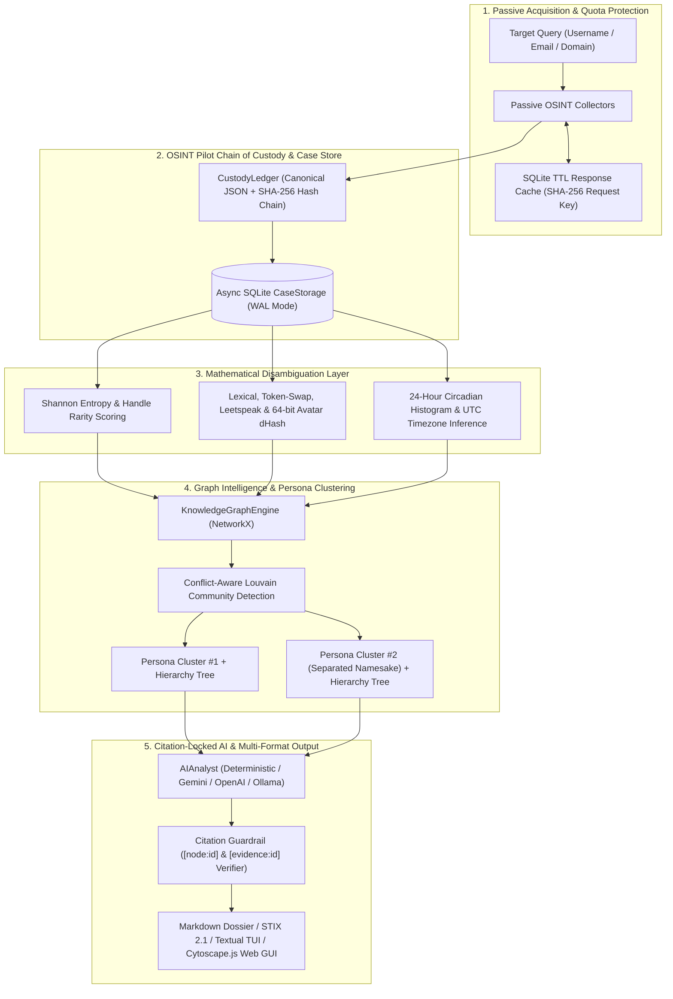

# OmniSINT — Open-Source OSINT Aggregation, Cryptographic Chain-of-Custody & Mathematical/AI Entity-Resolution Platform

[](https://www.python.org/downloads/)
[](https://docs.pydantic.dev/)
[](https://opensource.org/licenses/MIT)
[](#ethical-osint--evidentiary-standards)

**OmniSINT** is an enterprise-grade, open-source **Open-Source Intelligence (OSINT) Case Management, Mathematical Entity Disambiguation, and Citation-Locked AI Analysis Platform** built for cybersecurity specialists, threat intelligence analysts, digital forensics investigators, and open-source researchers.

---

## Table of Contents

1. [What Is OmniSINT? (In Plain English)](#1-what-is-omnisint-in-plain-english)
2. [Why Does OmniSINT Exist? The 4 Core Problems It Solves](#2-why-does-omnisint-exist-the-4-core-problems-it-solves)
3. [How OmniSINT Works: End-to-End Architecture](#3-how-omnisint-works-end-to-end-architecture)
4. [Real-World Walkthrough Example: Separating Colliding Namesakes](#4-real-world-walkthrough-example-separating-colliding-namesakes)
5. [Deep Dive into Every Module & Why Each Feature Exists](#5-deep-dive-into-every-module--why-each-feature-exists)
   - [5.1 Unified OSINT Ontology (`omnisint/core/models.py`)](#51-unified-osint-ontology-omnisintcoremodelspy)
   - [5.2 Cryptographic Chain of Custody (`omnisint/core/custody.py`)](#52-cryptographic-chain-of-custody-omnisintcorecustodypy)
   - [5.3 Async SQLite Case Store & TTL Response Cache (`omnisint/core/storage.py`)](#53-async-sqlite-case-store--ttl-response-cache-omnisintcorestoragepy)
   - [5.4 Information Theory: Shannon Entropy & Handle Rarity (`omnisint/intelligence/entropy.py`)](#54-information-theory-shannon-entropy--handle-rarity-omnisintintelligenceentropypy)
   - [5.5 Multi-Modal Similarity & Perceptual Avatar Hashing (`omnisint/intelligence/similarity.py`)](#55-multi-modal-similarity--perceptual-avatar-hashing-omnisintintelligencesimilaritypy)
   - [5.6 Circadian Rhythm & Timezone Fingerprinting (`omnisint/intelligence/temporal.py`)](#56-circadian-rhythm--timezone-fingerprinting-omnisintintelligencetemporalpy)
   - [5.7 Knowledge Graph, Conflict-Aware Louvain Clustering & Hierarchy Tree (`omnisint/intelligence/graph_engine.py`)](#57-knowledge-graph-conflict-aware-louvain-clustering--hierarchy-tree-omnisintintelligencegraph_enginepy)
   - [5.8 Citation-Locked AI Analyst & Dossier Synthesizer (`omnisint/intelligence/ai_analyst.py`)](#58-citation-locked-ai-analyst--dossier-synthesizer-omnisintintelligenceai_analystpy)
6. [Quickstart & Installation Guide](#6-quickstart--installation-guide)
7. [Complete Python API Examples](#7-complete-python-api-examples)
8. [Repository Architecture & Project Roadmap](#8-repository-architecture--project-roadmap)
9. [Open-Source Contributor Guide](#9-open-source-contributor-guide)
10. [Ethical OSINT & Evidentiary Standards](#10-ethical-osint--evidentiary-standards)

---

## 1. What Is OmniSINT? (In Plain English)

When a cybersecurity analyst, threat researcher, or investigator starts an investigation with a single clue—such as a username (`alex_dev`), an email address (`krypton@proton.me`), or a domain (`alexsec.io`)—they need to answer three fundamental questions:

1. **Discovery:** *Where else does this target appear across the public internet?* (Social profiles, GitHub/GitLab repositories, commit author emails, PGP/SSH keys, Certificate Transparency logs, passive DNS, subdomains, IP addresses).
2. **Disambiguation (Who is actually the same person?):** *Out of the 40 accounts found with a similar name or handle, which ones belong to our actual target, and which ones belong to completely unrelated people who just happen to share a similar name?*
3. **Evidentiary Proof (Can I prove it?):** *Can I prove mathematically and cryptographically—without AI hallucinations or tampered data—how every piece of evidence was collected and why two accounts were linked?*

**OmniSINT** is the engine that performs all three steps automatically, deterministically, and transparently. Instead of dumping a flat list of noisy URLs, OmniSINT:
- Collects and hashes every raw artifact into an **immutable SHA-256 Chain-of-Custody ledger**,
- Scores every handle, avatar image, and activity timestamp using **information theory and multi-modal mathematics**,
- Runs **Conflict-Aware Louvain Community Detection** on a NetworkX Knowledge Graph to separate colliding namesakes into clean **Persona Clusters**,
- Organizes each resolved persona's footprint into a structured **Information Hierarchy Tree** (`Root Persona` $\rightarrow$ `Accounts` / `Emails` / `Infrastructure` / `Organizations` / `Repositories`), and
- Generates a **Citation-Locked Executive Intelligence Dossier** where every claim is strictly bound to verified `[node:<id>]` and `[evidence:<id>]` identifiers.

---

## 2. Why Does OmniSINT Exist? The 4 Core Problems It Solves

| # | The Real-World OSINT Problem | Why Existing Tools Fail | How OmniSINT Solves It |
| :--- | :--- | :--- | :--- |
| **1** | **The "Namesake Collision" Problem**<br>Searching for `john_smith` or `alex_dev` returns dozens of accounts belonging to completely different people around the world. | Traditional username enumerators (e.g., Sherlock, Maigret) only check if `site.com/<username>` returns HTTP 200. They treat every match as the same target. | **Entropy + Multi-Modal Disambiguation:** OmniSINT computes handle collision probability, compares 64-bit perceptual avatar hashes (`dHash`), and correlates 24-hour circadian activity histograms to infer each account's timezone (`UTC+05:30` vs `UTC-07:00`). Incompatible accounts are locked into separate **Persona Clusters**. |
| **2** | **Handle Mutations & Token Swapping**<br>Real targets rarely use the exact same string everywhere: they use `john_doe_sec` on GitHub, `doejohnsec` on X/Twitter, and `j0hn_d0e_sec` on Keybase. | Exact-match lookup tools miss reordered tokens, concatenated handles, and leetspeak substitutions. | **Order-Invariant Token-Swap & Leetspeak Scoring:** OmniSINT splits handles across camelCase, digits, and delimiters, normalizes leetspeak (`0→o, 1→i, 3→e, 4→a, 5→s, 7→t`), and computes permutation coverage so `john_doe_sec` $\leftrightarrow$ `doejohnsec` scores `1.0`. |
| **3** | **Broken Chain of Custody**<br>Ad-hoc scripts and browser tabs lose track of *when* data was fetched, *where* it came from, and whether the raw JSON was altered afterward. | Most open-source OSINT tools overwrite files or print to stdout without cryptographic hashing or audit logs. | **OSINT Pilot-Standard Custody Ledger:** Every collected payload is canonicalized and hashed with **SHA-256** (`sha256_hash`) and chained to the previous record's `chain_hash` (blockchain-style). Modifying even a single character in stored evidence is immediately caught by `verify_chain()`. |
| **4** | **LLM Hallucinations in Threat Reports**<br>Feeding raw OSINT scrapes to an LLM often produces plausible-sounding fiction or unverified links. | Standard LLM wrappers lack mathematical pre-clustering and do not verify whether cited entities actually exist in the database. | **Math First, Citation-Locked AI Second:** OmniSINT resolves personas mathematically *before* any LLM is called. The `AIAnalyst` enforces inline `[node:<id>]` and `[evidence:<id>]` citations, audits every citation against the database, redacts any hallucinated IDs, and includes a built-in **100% offline deterministic synthesizer**. |

---

## 3. How OmniSINT Works: End-to-End Architecture



---

## 4. Real-World Walkthrough Example: Separating Colliding Namesakes

Suppose you are investigating the handle **`alex_dev`**. Your collectors return 4 social profiles and several connected artifacts:

1. **GitHub (`alex_dev`):** Commits made between `14:00–17:00+05:30` (India Standard Time), profile location `"Bengaluru, India"`, commit email `alex.sec@proton.me`, owns repo `github.com/alex_dev/omnisint` and domain `alexsec.in` (`api.alexsec.in` $\rightarrow$ `203.0.113.10`).
2. **Twitter/X (`dev_alex_sec`):** Posts made between `14:30–16:45+05:30`, profile location `"Bengaluru, India"`, uses the exact same avatar image (slightly recompressed by Twitter).
3. **GitLab (`alex_dev`):** Commits made between `14:00–16:30-07:00` (US Pacific Time), location `"Seattle, USA"`, email `alex@seattle-cloud.io`, owns repo `gitlab.com/alex_dev/k8s-tools`.
4. **Reddit (`alex_dev`):** Posts made between `14:30–16:25-07:00`, location `"Seattle, USA"`, email `alex@seattle-cloud.io`.

### How OmniSINT Processes This Automatically:

1. **Entropy & Rarity Check (`entropy.py`):**
   - `alex_dev` consists of two very common dictionary/name tokens (`alex` and `dev`).
   - OmniSINT assigns `alex_dev` a **low rarity score (`0.22`)** and flags `is_high_collision_risk = True`.
   - **Why this matters:** Because `alex_dev` is a high-collision handle, OmniSINT refuses to merge accounts based on the handle name alone! It requires **multi-modal corroboration** (avatar match, timezone alignment, or shared hard selector).
2. **Multi-Modal Pairwise Comparison (`similarity.py` & `temporal.py`):**
   - **GitHub (`alex_dev`) vs Twitter (`dev_alex_sec`):**
     - `token_swap_similarity("alex_dev", "dev_alex_sec")` detects shared reordered tokens (`alex`, `dev`).
     - `avatar_hash_similarity` compares their 64-bit `dHash` fingerprints $\rightarrow$ **`0.98` match** (`SAME_AVATAR` edge created).
     - `correlate_timestamps` compares their 24-hour UTC activity vectors $\rightarrow$ both infer **`UTC+05:30`** with **`0.94` circadian correlation** (`TEMPORAL_CORRELATION` edge created).
   - **GitHub (`alex_dev`, Bengaluru `UTC+05:30`) vs GitLab (`alex_dev`, Seattle `UTC-07:00`):**
     - Even though the username string `"alex_dev"` is 100% identical, `correlate_timestamps` detects a **12.5-hour timezone divergence (`UTC+05:30` vs `UTC-07:00`)** and incompatible locations (`"Bengaluru, India"` vs `"Seattle, USA"`).
     - `KnowledgeGraphEngine` records a **must-not-link conflict constraint** between them!
3. **Conflict-Aware Louvain Clustering & Hierarchy Tree (`graph_engine.py`):**
   - Partitions the graph into **2 clean Persona Clusters** and attaches each persona's child emails, keys, repositories, and domains into structured **Information Hierarchy Trees**:

```text
Persona #1: alex_dev (UTC+05:30, Bengaluru, India) [conf=0.93, H=2.75]
├── Accounts (3)
│   ├── [social_profile] GitHub:alex_dev (id=a-github, conf=0.75) (ev:1)
│   │   └── [avatar_hash] 8f3c3c1e1e0f0f00 (id=a-avatar, conf=0.75) (ev:1)
│   └── [social_profile] Twitter:dev_alex_sec (id=a-twitter, conf=0.75) (ev:1)
├── Emails (2)
│   ├── [email] alex.sec@proton.me (id=a-email, conf=0.75) (ev:1)
│   └── [pgp_key] 0x99AABBCC11223344 (id=a-pgp, conf=0.75) (ev:1)
├── Infrastructure (3)
│   └── [domain] alexsec.in (id=a-domain, conf=0.75) (ev:1)
│       └── [subdomain] api.alexsec.in (id=a-subdomain, conf=0.75) (ev:1)
│           └── [ip_address] 203.0.113.10 (id=a-ip, conf=0.75) (ev:1)
└── Repositories (1)
    └── [repository] github.com/alex_dev/omnisint (id=a-repo, conf=0.75) (ev:1)

Persona #2: alex_dev (UTC-07:00, Seattle, USA) [conf=0.91, H=2.52]
├── Accounts (2)
│   ├── [social_profile] GitLab:alex_dev (id=b-gitlab, conf=0.75) (ev:1)
│   └── [social_profile] Reddit:alex_dev (id=b-reddit, conf=0.75) (ev:1)
├── Emails (1)
│   └── [email] alex@seattle-cloud.io (id=b-email, conf=0.75) (ev:1)
├── Organizations (1)
│   └── [organization] PacificCloud Inc (id=b-org, conf=0.75) (ev:1)
└── Repositories (1)
    └── [repository] gitlab.com/alex_dev/k8s-tools (id=b-repo, conf=0.75) (ev:1)
```

---

## 5. Deep Dive into Every Module & Why Each Feature Exists

### 5.1 Unified OSINT Ontology (`omnisint/core/models.py`)

#### Why It Exists
OSINT data comes from wildly different sources (GitHub JSON, WHOIS records, Certificate Transparency logs, social media profiles). Without a strict, unified data model, collectors produce incompatible dictionaries that cannot be merged or validated.

#### What It Contains
- **`EntityType` (17 Canonical Types):** `PERSON`, `USERNAME`, `SOCIAL_PROFILE`, `EMAIL`, `DOMAIN`, `SUBDOMAIN`, `IP_ADDRESS`, `REPOSITORY`, `ORGANIZATION`, `PGP_KEY`, `SSH_KEY`, `AVATAR_HASH`, `URL`, `PHONE`, `LOCATION`, `CERTIFICATE`, `THREAT_INDICATOR`.
- **`RelationType` (19 Directed & Symmetric Link Types):**
  - *Structural links:* `HAS_HANDLE`, `HAS_PROFILE`, `HAS_EMAIL`, `OWNS_DOMAIN`, `HAS_SUBDOMAIN`, `RESOLVES_TO`, `ISSUED_CERT`, `COMMITTED_TO`, `OWNS_REPO`, `USES_KEY`, `HAS_AVATAR`, `MEMBER_OF`, `LOCATED_IN`, `MENTIONED_AT`, `FLAGGED_BY`.
  - *Mathematical disambiguation links:* `SIMILAR_HANDLE`, `SAME_AVATAR`, `TEMPORAL_CORRELATION`, `RESOLVED_SAME_PERSONA`.
- **`EntityNode`:** Every vertex in the intelligence graph. Includes `canonical_key` (`<entity_type>:<platform>:<lowercase_value>`) so if two collectors independently discover `GitHub:Alex_Sec` and `github:alex_sec`, OmniSINT automatically deduplicates them into a single canonical node while merging their `evidence_ids` and `attributes`.
- **`RelationshipEdge`:** Weighted, confidence-scored link between two `EntityNode`s with a Pydantic validator that prevents self-referential loops (`source_node_id != target_node_id`).
- **`PersonaCluster` & `HierarchyTreeNode`:** Represent a disambiguated real-world identity cluster and its recursive 5-category Information Hierarchy Tree.
- **`Case` & `EvidenceItem`:** The top-level investigative container holding the graph, resolved personas, SHA-256 evidence ledger, chronological audit log, and AI executive brief.

---

### 5.2 Cryptographic Chain of Custody (`omnisint/core/custody.py`)

#### Why It Exists
In professional threat intelligence, corporate investigations, and law enforcement, raw OSINT findings are useless if you cannot prove **when** they were collected, **where** they came from, and that **nobody modified the payload** after collection.

#### How It Works
1. **Deterministic Canonicalization (`canonicalize_payload`):** JSON dictionaries have no guaranteed key order in memory (`{"b": 1, "a": 2}` vs `{"a": 2, "b": 1}`). OmniSINT serializes structured payloads with `sort_keys=True, separators=(",", ":")` into canonical UTF-8 bytes before hashing so the exact same data always yields the exact same 64-character hex SHA-256 digest.
2. **Blockchain-Style Hash Chaining (`compute_chain_hash`, `CustodyLedger`):**
   - Item #1 links to `GENESIS_CHAIN_HASH` (`"0" * 64`).
   - Item #$k$ computes its `chain_hash` over:
     $$\text{chain\_hash}_k = \text{SHA256}\left(\text{prev\_chain\_hash}_{k-1} \;\|\; \text{evidence\_id}_k \;\|\; \text{sha256\_hash}_k \;\|\; \text{collected\_at\_utc}_k \;\|\; \text{collector\_name}_k \;\|\; \text{source\_uri}_k\right)$$
3. **Tamper Detection (`verify_item`, `verify_chain`):** Recomputes every payload hash and sequential link. If anyone alters a payload in memory or in SQLite, `verify_chain()` immediately returns `(False, ["Evidence <id>: payload SHA-256 mismatch..."])`.

---

### 5.3 Async SQLite Case Store & TTL Response Cache (`omnisint/core/storage.py`)

#### Why It Exists
1. **Persistence:** Investigations span multiple sessions and collectors; all cases, deduplicated nodes/edges, personas, and custody chains must persist reliably to disk with zero external database setup.
2. **API Quota & Rate-Limit Protection:** OSINT APIs (GitHub, VirusTotal, crt.sh, WHOIS) enforce strict rate limits. Re-running a scan on the same target shouldn't burn API quotas if a fresh response is already cached locally.

#### How It Works
- Manages 6 SQLite tables (`cases`, `entities`, `edges`, `evidence_items`, `audit_log`, `http_cache`) using Write-Ahead Logging (`PRAGMA journal_mode = WAL`) and foreign-key cascading (`ON DELETE CASCADE`).
- **`merge_collector_result(case_id, result)`:** Concurrently ingests `CollectorResult` objects, deduplicating nodes by `canonical_key`, remapping edge endpoint IDs to the surviving canonical `node_id`, and appending `EvidenceItem` records into the case's cryptographic hash chain.
- **Deterministic TTL Cache (`make_cache_key`, `get_cached_response`, `set_cached_response`):** Hashes `(collector_name, query_or_uri, canonical_params)` into a SHA-256 key and stores the response with a configurable Time-To-Live (`expires_at_utc`), automatically evicting expired entries on lookup.

---

### 5.4 Information Theory: Shannon Entropy & Handle Rarity (`omnisint/intelligence/entropy.py`)

#### Why It Exists
Not all usernames carry the same evidentiary weight.
- If two accounts on different platforms both use the handle **`x7_krypton_99`**, the probability that two unrelated humans independently chose `x7_krypton_99` is near zero.
- If two accounts both use **`john_smith`** or **`alex`**, the probability that they are two different people is extremely high.

#### How It Works
1. **Shannon Entropy ($H$):** Measures character-level unpredictability in bits per character:
   $$H(X) = -\sum_{c \in \Sigma} P(c) \log_2 P(c)$$
   Total information content is $I(X) = |X| \cdot H(X)$ bits.
2. **N-Gram Bigram Rarity:** Checks what fraction of 2-character sequences in the handle are outside the 50 most common English bigrams (`th`, `he`, `in`, `er`, `an`, etc.). Handles with `x7`, `kr`, `0x`, `qz` score high on bigram rarity.
3. **Human Name & Generic Token Penalty (`COMMON_NAME_TOKENS`):** Tokenizes handles across delimiters (`_`, `-`, `.`), camelCase (`JohnDoe`), and digits, then checks tokens against a curated dictionary of high-collision human names (`john`, `alex`, `smith`, `jones`, `maria`) and generic words (`admin`, `dev`, `crypto`, `official`).
4. **Collision Probability (`estimate_collision_probability`):** Outputs a `[0.0, 1.0]` probability that two accounts with this handle belong to different people (`john_smith` $\rightarrow$ `> 0.65` high collision risk; `x7_krypton_99` $\rightarrow$ `< 0.25` low collision risk).

---

### 5.5 Multi-Modal Similarity & Perceptual Avatar Hashing (`omnisint/intelligence/similarity.py`)

#### Why It Exists
People modify their handles across platforms (`krypton_sec` $\rightarrow$ `krypton_sec_dev`, `john_doe_sec` $\rightarrow$ `doejohnsec`, `alex_sec` $\rightarrow$ `4l3x_s3c`) while often reusing the same profile picture (avatar).

#### How It Works
1. **Jaro-Winkler & Normalized Levenshtein (`jaro_winkler_similarity`, `normalized_levenshtein`):** Captures minor typos, prefixes, and suffixes (`_dev`, `_official`, `99`).
2. **Order-Invariant & Concatenated Token-Swap Matching (`token_swap_similarity`):**
   - Solves both delimited reordering (`john_doe_sec` $\leftrightarrow$ `sec_john_doe` $= 1.0$) AND delimiter-free concatenation (`john_doe_sec` $\leftrightarrow$ `doejohnsec` $= 1.0$) using Dice token overlap combined with greedy sub-token stripping and permutation edit distance.
3. **Leetspeak Normalization (`normalize_leet`):** Translates `0→o, 1→i, 3→e, 4→a, 5→s, 7→t, @→a, $→s` before comparing handles.
4. **64-Bit Perceptual Avatar Difference Hashing (`compute_dhash_from_pixels`, `compute_dhash_from_bytes`, `avatar_hash_similarity`):**
   - Computes a 16-hex-character (64-bit) horizontal gradient hash across an $8 \times 9$ luminance grid and measures bit-level Hamming distance:
     $$\text{Similarity}_{\text{avatar}} = 1.0 - \frac{\text{PopCount}(\text{hash}_1 \oplus \text{hash}_2)}{64}$$
   - Even if a platform resizes or recompresses an avatar image, its horizontal brightness gradients remain nearly identical (`avatar_hash_similarity >= 0.90`).

---

### 5.6 Circadian Rhythm & Timezone Fingerprinting (`omnisint/intelligence/temporal.py`)

#### Why It Exists
Public timestamps (Git commits, Reddit posts, forum replies, Mastodon statuses) are behavioral biometrics. A person living in Bengaluru (`UTC+05:30`) sleeps during hours when a person in Seattle (`UTC-07:00`) is wide awake and pushing code.

#### How It Works
1. **24-Hour UTC Activity Histogram (`build_temporal_profile`):** Bins all timestamps into 24 UTC hour slots (`00` through `23`) and computes the weekend activity ratio.
2. **Dual Timezone Inference:**
   - If timestamps contain explicit non-UTC offsets (such as Git commit headers `+05:30` or `-07:00`), extracts the modal timezone offset directly.
   - If timestamps are normalized to `Z` (`+00:00`), locates the **7-hour biological sleep trough** (minimum activity window) and aligns its center with `03:30` local time to infer the operator's UTC offset (`UTC+HH:MM`).
3. **3-Hour Kernel-Smoothed Cosine Similarity (`correlate_temporal_profiles`):**
   - Applies a circular `[0.25, 0.50, 0.25]` smoothing kernel across adjacent hours to tolerate $\pm 1\text{h}$ daily routine jitter, then combines smoothed circadian cosine similarity (`45%`), circular timezone offset alignment (`35%`), raw hourly cosine (`10%`), and weekend cadence similarity (`10%`).

---

### 5.7 Knowledge Graph, Conflict-Aware Louvain Clustering & Hierarchy Tree (`omnisint/intelligence/graph_engine.py`)

#### Why It Exists
Pairwise scores alone don't group 30 entities into distinct people. We need a graph algorithm that merges corroborated accounts into **Persona Clusters**, prevents colliding namesakes from bridging together, and structures every persona's assets into a visual hierarchy tree.

#### How It Works
1. **Automatic Similarity Edge Synthesis (`synthesize_similarity_edges`):**
   - Evaluates candidate identity nodes and generates weighted `SIMILAR_HANDLE`, `SAME_AVATAR`, `TEMPORAL_CORRELATION`, and `RESOLVED_SAME_PERSONA` edges.
   - Records **must-not-link conflict pairs** whenever two nodes exhibit incompatible timezones (`timezone_alignment_score <= 0.50`), conflicting physical locations (`"Bengaluru, India"` vs `"Seattle, USA"`), divergent avatar hashes on common handles, or uncorroborated identical common-name handles (`john_smith`).
2. **Two-Stage Conflict-Aware Louvain Clustering (`detect_persona_clusters`):**
   - **Stage 1 (Identity Core Louvain):** Runs Blondel et al. (2008) Newman-Girvan modularity optimization over identity anchors while forbidding any merge between nodes in `_conflict_pairs`.
   - **Stage 2 (Multi-Hop Observable Propagation):** Propagates persona ownership from the resolved identity clusters out to connected emails, PGP/SSH keys, repositories, domains, subdomains, IPs, certificates, and organizations via weighted shortest-path traversal.
3. **Recursive Information Hierarchy Tree (`build_hierarchy_tree`):**
   - Builds a 5-branch tree under `Root Persona`:
     - `Accounts` (`PERSON`, `USERNAME`, `SOCIAL_PROFILE` $\rightarrow$ nested `AVATAR_HASH`)
     - `Emails` (`EMAIL`, `PHONE`, `PGP_KEY`, `SSH_KEY`)
     - `Infrastructure` (`DOMAIN` $\rightarrow$ nested `SUBDOMAIN` $\rightarrow$ nested `IP_ADDRESS` / `CERTIFICATE`)
     - `Organizations` (`ORGANIZATION`, `LOCATION`)
     - `Repositories` (`REPOSITORY`)

---

### 5.8 Citation-Locked AI Analyst & Dossier Synthesizer (`omnisint/intelligence/ai_analyst.py`)

#### Why It Exists
Investigators need an executive-ready intelligence dossier with an **Identity Confidence Matrix**, disambiguation rationale, and next-hop pivot recommendations—**with zero risk of AI hallucinations**.

#### How It Works
1. **Identity Confidence Matrix (`build_identity_matrix`):** Summarizes every resolved `PersonaCluster` with a numeric score, tier (`HIGH`, `MEDIUM`, `LOW`), average handle entropy, inferred timezone, corroborating modalities, and citations.
2. **Pluggable LLM Providers + Built-In Offline Synthesizer:**
   - Works **100% offline out-of-the-box** using `provider="deterministic"`.
   - Optionally connects to **Google Gemini** (`gemini`), **OpenAI** (`openai`), or local **Ollama** (`ollama`), with automatic fallback to `deterministic` if an API key is missing or an endpoint is offline.
3. **Citation Verification & Hallucination Redaction Guardrail (`audit_citations`, `sanitize_hallucinated_citations`):**
   - Parses every `[node:<id>]` and `[evidence:<id>]` tag in the output and verifies them against the Case's actual `EntityNode` and `EvidenceItem` records.
   - Any unverified ID is immediately replaced with `[REDACTED-UNVERIFIED-NODE:<id>]` / `[REDACTED-UNVERIFIED-EVIDENCE:<id>]` and supplemented with the verified deterministic appendix.

---

## 6. Quickstart & Installation Guide

### Prerequisites
- **Python 3.11+** (tested on Python 3.11, 3.12, 3.13, and 3.14)
- **macOS, Linux, or Windows (WSL2)**

### Step 1: Clone the Repository & Install Dependencies
```bash
git clone https://github.com/SamAlex-22/OmniSINT.git
cd OmniSINT

# Create and activate a virtual environment
python3 -m venv .venv
source .venv/bin/activate

# Install OmniSINT in editable mode with development/test extras
pip install -e ".[dev]"
```

### Step 2: Configure Environment Variables (Optional)
OmniSINT runs out-of-the-box with **zero API keys** using its passive collectors, local SQLite store, and deterministic intelligence synthesizer. To enable optional external APIs or cloud LLMs, copy `.env.example` to `.env`:
```bash
cp .env.example .env
```
Available settings in `.env`:
```ini
OMNISINT_DATABASE_PATH=.omnisint_data/omnisint.db
OMNISINT_CACHE_TTL_SECONDS=86400
OMNISINT_LLM_PROVIDER=deterministic   # Options: deterministic, gemini, openai, ollama
OMNISINT_LLM_MODEL=gemini-2.5-flash
OMNISINT_LLM_API_KEY=                 # Optional API key for Gemini or OpenAI
OMNISINT_GITHUB_TOKEN=                # Optional GitHub PAT for higher rate limits
OMNISINT_VIRUSTOTAL_API_KEY=          # Optional VirusTotal v3 API key
```

### Step 3: Run the Verification Test Suite
All unit and integration tests are deterministic and run completely offline in `< 0.1s`:
```bash
pytest -v
# Or using Python's built-in unittest runner:
python3 -m unittest discover -s tests -v
```

---

## 7. Complete Python API Examples

### Example 1: End-to-End Case Creation, Cryptographic Custody, Disambiguation & AI Dossier
```python
from omnisint.core.custody import CustodyLedger
from omnisint.core.models import Case, EntityNode, EntityType, RelationshipEdge, RelationType
from omnisint.intelligence.ai_analyst import AIAnalyst
from omnisint.intelligence.graph_engine import KnowledgeGraphEngine, render_hierarchy_ascii

# 1. Initialize an OSINT Pilot Chain-of-Custody Ledger for a new Case
ledger = CustodyLedger(case_id="case-2026-001")

ev_gh = ledger.record_evidence(
    collector_name="github_collector",
    source_uri="https://api.github.com/users/krypton_sec_x7",
    raw_payload={"login": "krypton_sec_x7", "location": "Bengaluru, India"},
)
ev_tw = ledger.record_evidence(
    collector_name="username_collector",
    source_uri="https://x.com/x7kryptonsec",
    raw_payload={"handle": "x7kryptonsec", "location": "Bengaluru, India"},
)

# Verify cryptographic SHA-256 chain integrity
is_valid, violations = ledger.verify_chain()
assert is_valid and not violations

# 2. Build the Case with discovered EntityNodes
case = Case(
    case_id="case-2026-001",
    title="Krypton Threat Actor Footprint",
    target_query="krypton_sec_x7",
    nodes=[
        EntityNode(
            node_id="n-gh",
            entity_type=EntityType.SOCIAL_PROFILE,
            value="krypton_sec_x7",
            platform="GitHub",
            evidence_ids=[ev_gh.evidence_id],
            attributes={"timestamps": ["2026-05-04T14:15:00+05:30", "2026-05-05T15:30:00+05:30"]},
        ),
        EntityNode(
            node_id="n-tw",
            entity_type=EntityType.SOCIAL_PROFILE,
            value="x7kryptonsec",
            platform="Twitter",
            evidence_ids=[ev_tw.evidence_id],
            attributes={"timestamps": ["2026-05-06T14:45:00+05:30", "2026-05-07T16:10:00+05:30"]},
        ),
        EntityNode(
            node_id="n-repo",
            entity_type=EntityType.REPOSITORY,
            value="github.com/krypton_sec_x7/omnisint",
            evidence_ids=[ev_gh.evidence_id],
        ),
    ],
    edges=[
        RelationshipEdge(
            source_node_id="n-gh",
            target_node_id="n-repo",
            relation_type=RelationType.OWNS_REPO,
            evidence_ids=[ev_gh.evidence_id],
        )
    ],
    evidence_ledger=ledger.evidence_items,
    audit_log=ledger.audit_log,
)

# 3. Run Mathematical Disambiguation, Louvain Persona Clustering & Citation-Locked AI Analysis
analyst = AIAnalyst(provider="deterministic")
report = analyst.analyze_case_sync(case)

print(render_hierarchy_ascii(case.personas[0].hierarchy_tree))
print(report.executive_brief)
```

---

## 8. Repository Architecture & Project Roadmap

```text
OmniSINT/
├── README.md                        # Comprehensive platform & contributor documentation
├── AGENTS.md                        # Engineering standards, module boundaries & agent rules
├── TASKS.md                         # 10-stage architectural blueprint & task specifications
├── Milestone.md                     # Detailed engineering chronicle of completed milestones
├── pyproject.toml                   # Python packaging, dependencies, ruff & pytest config
├── scripts/
│   └── update_code_graph.py         # Deterministic AST & Graphify knowledge-graph indexer
├── graphify-out/                    # Auto-generated codebase knowledge graph & report
│   ├── GRAPH_REPORT.md
│   └── graph.json
├── omnisint/
│   ├── __init__.py
│   ├── config.py                    # Pydantic v2 Settings (DB path, TTL, API keys, LLM provider)
│   ├── core/
│   │   ├── models.py                # Unified EntityNode, RelationshipEdge, Case, EvidenceItem schemas
│   │   ├── custody.py               # SHA-256 Chain of Custody ledger & tamper verification
│   │   ├── storage.py               # Async SQLite CaseStorage + TTL collector response cache
│   │   └── orchestrator.py          # Async scan orchestrator & multi-hop pivot engine (Task 8)
│   ├── intelligence/
│   │   ├── entropy.py               # Shannon entropy, bigram rarity & collision probability
│   │   ├── similarity.py            # Jaro-Winkler, Levenshtein, token-swap, leetspeak & avatar dHash
│   │   ├── temporal.py              # 24h circadian activity histogram & UTC timezone inference
│   │   ├── graph_engine.py          # NetworkX graph, conflict-aware Louvain & Hierarchy Tree
│   │   └── ai_analyst.py            # Citation-locked AI analyst & Identity Confidence Matrix
│   ├── collectors/                  # Pluggable passive OSINT collectors (Tasks 6 & 7)
│   ├── reporting/                   # Markdown dossier & STIX 2.1 bundle exporters (Task 8)
│   ├── api/                         # FastAPI REST + WebSocket backend (Task 9)
│   └── cli/                         # Typer CLI & Textual interactive terminal dashboard (Task 10)
├── web/                             # Cytoscape.js interactive graph & hierarchy tree Web GUI (Task 9)
└── tests/                           # Offline deterministic unit & async integration test suite
```

### Implementation Status
- [x] **Task 0:** Project Initialization, Package Skeleton, `AGENTS.md`, & Graphify AST Indexer (`scripts/update_code_graph.py`)
- [x] **Task 1:** Core Ontology & OSINT Pilot Chain-of-Custody Engine (`omnisint/core/models.py`, `omnisint/core/custody.py`)
- [x] **Task 2:** Async SQLite Case Store & TTL Response Cache (`omnisint/core/storage.py`)
- [x] **Task 3:** Mathematical Disambiguation Part 1 — Shannon Entropy, Handle Rarity & Multi-Modal Similarity (`omnisint/intelligence/entropy.py`, `omnisint/intelligence/similarity.py`, `omnisint/intelligence/temporal.py`)
- [x] **Task 4:** Mathematical Disambiguation Part 2 — NetworkX Knowledge Graph, Louvain Persona Clustering & Hierarchy Tree (`omnisint/intelligence/graph_engine.py`)
- [x] **Task 5:** Citation-Locked AI Analyst & Persona Dossier Synthesizer (`omnisint/intelligence/ai_analyst.py`)
- [ ] **Task 6:** Pluggable Collector Framework + Username & GitHub/PGP Collectors (`omnisint/collectors/base.py`, `username_collector.py`, `github_collector.py`)
- [ ] **Task 7:** Infrastructure, Threat Intel & Search Dork Collectors (`domain_ct_collector.py`, `threat_intel.py`, `search_dork_collector.py`)
- [ ] **Task 8:** Async Scan Orchestrator, Cross-Indicator Pivot Engine & STIX 2.1 / Markdown Exporters (`omnisint/core/orchestrator.py`, `omnisint/reporting/`)
- [ ] **Task 9:** FastAPI Backend, WebSocket Live Stream & Cytoscape.js Interactive Web GUI (`omnisint/api/`, `web/index.html`)
- [ ] **Task 10:** Typer CLI & Textual Interactive Terminal Dashboard (`omnisint/cli/main.py`, `omnisint/cli/tui.py`) + End-to-End Integration Suite

---

## 9. Open-Source Contributor Guide

We welcome contributions from cybersecurity specialists, OSINT researchers, data scientists, and Python/React developers!

### Engineering Standards for Contributors
1. **Strict Type Annotations & Pydantic v2:** Every function must include Python 3.11+ type annotations, and all data structures must use Pydantic v2 `BaseModel` schemas with `ConfigDict(extra="forbid")`.
2. **Evidentiary Chain of Custody:** Every collector plugin must record an `EvidenceItem` with a canonical SHA-256 digest and source URI for every external response.
3. **Offline Deterministic Unit Tests:** Every module added to `core/`, `intelligence/`, `collectors/`, `reporting/`, `api/`, or `cli/` must include fast, offline unit tests in `tests/` (mocking external HTTP requests).
4. **Keep the Codebase Knowledge Graph Updated:** After adding or modifying modules, run:
   ```bash
   python3 scripts/update_code_graph.py
   ```
   This updates `graphify-out/GRAPH_REPORT.md` and `graphify-out/graph.json` so contributors and AI coding agents can navigate module boundaries and high-centrality abstractions effortlessly.

---

## 10. Ethical OSINT & Evidentiary Standards

OmniSINT is designed strictly for **passive, authorized open-source intelligence, defensive threat hunting, digital forensics, and academic research**:
- **Passive-First:** Collectors query only publicly accessible records and documented APIs, respecting rate limits, exponential backoff, and local TTL caching.
- **No Active Exploitation or Access Bypass:** OmniSINT never performs credential stuffing, authentication bypass, active vulnerability scanning, or CAPTCHA circumvention.
- **Zero Unverified Speculation:** All entity links and AI-generated narratives are mathematically scored and cryptographically bound to `[node:<id>]` and `[evidence:<id>]` citations.
